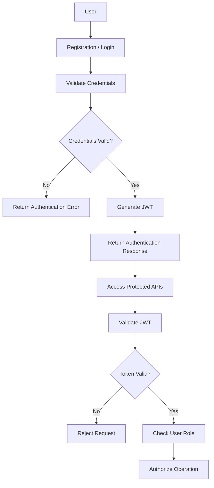
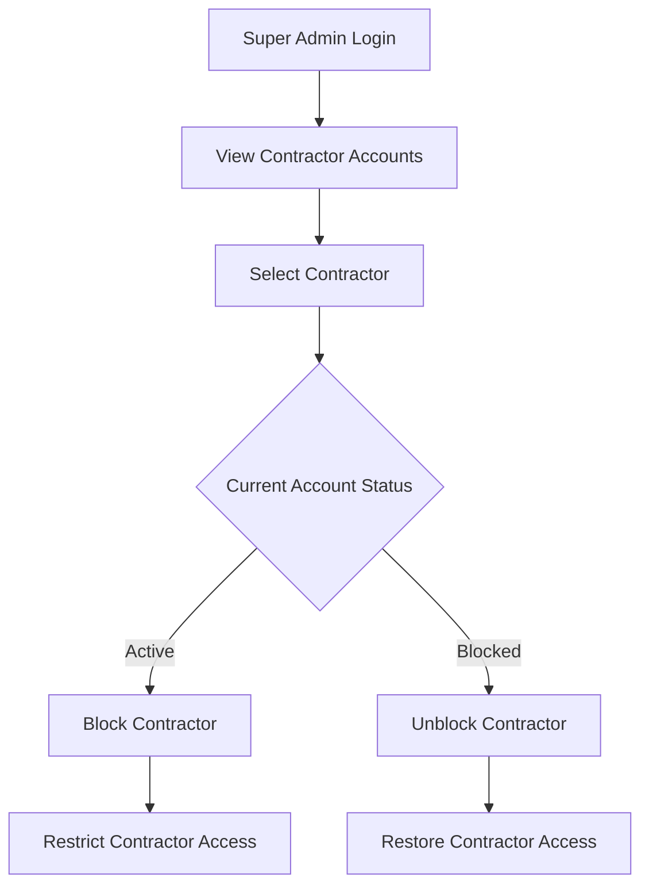
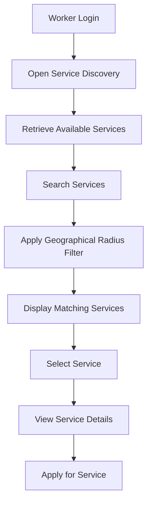
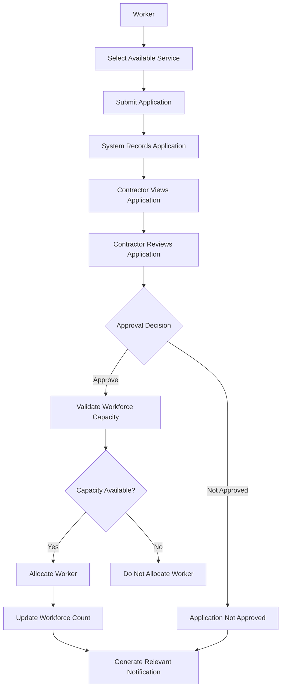
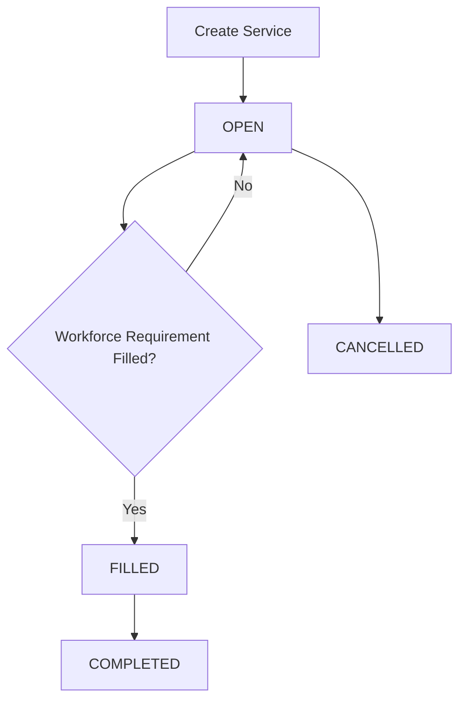

# WorkBridge — Functional Requirements

**Document:** Functional Requirements Specification  
**Project:** WorkBridge  
**Version:** 1.0  
**Status:** Initial Requirements Documentation

---

# 1. Introduction

This document defines the functional requirements of WorkBridge.

It describes the operations that the application must support, the responsibilities of each user role, the expected system behaviour and the business rules governing each operation.

WorkBridge consists of three user roles:

1. SUPER_ADMIN
2. CONTRACTOR
3. WORKER

The requirements in this document are based on the existing WorkBridge functionality and the agreed Super Admin responsibilities.

# 2. User Roles

| Role | Description | Primary Responsibility |
|---|---|---|
| SUPER_ADMIN | Platform owner | Manage contractor access and oversee the platform. |
| CONTRACTOR | Work provider | Publish services and manage worker applications. |
| WORKER | Work seeker | Discover services and apply for opportunities. |

# 3. Authentication and Authorization Requirements

## 3.1 Functional Requirements

| ID | Requirement | Expected Behaviour |
|---|---|---|
| FR-001 | Contractor Registration | The system must allow contractors to register. |
| FR-002 | Worker Registration | The system must allow workers to register. |
| FR-003 | User Login | Registered users must be able to log in. |
| FR-004 | Password Encryption | Passwords must be encrypted using BCrypt before storage. |
| FR-005 | JWT Generation | The system must generate JWT tokens after successful authentication. |
| FR-006 | JWT Validation | The system must validate JWT tokens for protected requests. |
| FR-007 | Role-Based Authorization | The system must restrict operations according to user roles. |
| FR-008 | Super Admin Provisioning | Super Admin access must be established securely and must not be available through public registration. |

## 3.2 Authentication Workflow

# 4. SUPER_ADMIN Functional Requirements

The Super Admin is the highest-authority user of the WorkBridge platform.

The primary administrative responsibility established for this rebuild is contractor account management, including blocking and unblocking contractors.

## 4.1 Functional Requirements

| ID | Requirement | Expected Behaviour |
|---|---|---|
| FR-009 | Super Admin Login | The Super Admin must be able to authenticate securely. |
| FR-010 | View Contractors | The Super Admin must be able to view contractor accounts. |
| FR-011 | Block Contractor | The Super Admin must be able to block a contractor. |
| FR-012 | Unblock Contractor | The Super Admin must be able to unblock a previously blocked contractor. |
| FR-013 | Contractor Access Control | The system must prevent blocked contractors from accessing protected contractor operations. |

## 4.2 Contractor Blocking Workflow

## 4.3 Administrative Business Rules

| ID | Rule |
|---|---|
| SAR-001 | Only the Super Admin can block contractors. |
| SAR-002 | Only the Super Admin can unblock contractors. |
| SAR-003 | A blocked contractor must not access protected contractor functionality. |
| SAR-004 | Contractors cannot perform Super Admin operations. |
| SAR-005 | Workers cannot perform Super Admin operations. |

**Open requirement:** The effect of blocking a contractor on existing services, applications and previously approved workers must be finalized before implementation.

# 5. CONTRACTOR Functional Requirements

Contractors are responsible for publishing work opportunities, managing services and approving workers.

## 5.1 Account Management

| ID | Requirement | Expected Behaviour |
|---|---|---|
| FR-014 | Contractor Registration | A new contractor must be able to register. |
| FR-015 | Contractor Login | A registered contractor must be able to log in. |
| FR-016 | Contractor Profile | The contractor must be able to maintain contractor profile information. |

## 5.2 Service Management

| ID | Requirement | Expected Behaviour |
|---|---|---|
| FR-017 | Create Service | Contractors must be able to create service listings. |
| FR-018 | Update Service | Contractors must be able to update their existing services. |
| FR-019 | Delete Service | Contractors must be able to delete their existing services. |
| FR-020 | Retrieve Services | Contractors must be able to retrieve their service listings. |
| FR-021 | View Service Details | Contractors must be able to view individual service details. |
| FR-022 | Define Workforce | Contractors must specify the required worker count. |
| FR-023 | Update Workforce | Contractors must be able to update workforce requirements. |
| FR-024 | Service Status | The system must maintain service status according to business rules. |

## 5.3 Application Management

| ID | Requirement | Expected Behaviour |
|---|---|---|
| FR-025 | View Applications | Contractors must be able to view applications submitted for their services. |
| FR-026 | Review Applications | Contractors must be able to review worker applications. |
| FR-027 | Approve Applications | Contractors must be able to approve suitable worker applications. |
| FR-028 | Workforce Allocation | The system must update workforce allocation following approval. |
| FR-029 | Workforce Validation | The system must prevent approved worker count from exceeding required workforce. |

## 5.4 Contractor Notifications

| ID | Requirement | Expected Behaviour |
|---|---|---|
| FR-030 | Receive Notifications | Contractors must receive relevant application notifications. |
| FR-031 | Retrieve Notifications | Contractors must be able to retrieve their notifications. |
| FR-032 | Unread Notifications | Contractors must be able to retrieve unread notifications. |
| FR-033 | Read Notification | The system must maintain notification read status. |

## 5.5 Payment and Payout

| ID | Requirement | Expected Behaviour |
|---|---|---|
| FR-034 | Initiate Payment | The existing system must support simulated payment initiation. |
| FR-035 | Confirm Payment | The existing system must support payment confirmation. |
| FR-036 | Failed Payment | The system must handle simulated payment failures. |
| FR-037 | Payout Processing | The existing system must support simulated payout processing. |

# 6. WORKER Functional Requirements

Workers are responsible for discovering available services and applying for suitable work opportunities.

## 6.1 Account Management

| ID | Requirement | Expected Behaviour |
|---|---|---|
| FR-038 | Worker Registration | New workers must be able to register. |
| FR-039 | Worker Login | Registered workers must be able to log in. |
| FR-040 | Worker Profile | Workers must be able to maintain their profile information. |

## 6.2 Service Discovery

| ID | Requirement | Expected Behaviour |
|---|---|---|
| FR-041 | View Services | Workers must be able to view available services. |
| FR-042 | Search Services | Workers must be able to search for suitable services. |
| FR-043 | Radius-Based Search | Workers must be able to discover services within a geographical radius. |
| FR-044 | View Service Details | Workers must be able to view individual service information. |

## 6.3 Application Management

| ID | Requirement | Expected Behaviour |
|---|---|---|
| FR-045 | Apply for Service | Workers must be able to apply for eligible services. |
| FR-046 | Track Applications | Workers must be able to track their submitted applications. |
| FR-047 | Application Updates | Workers must be able to view relevant application updates. |

## 6.4 Worker Notifications

| ID | Requirement | Expected Behaviour |
|---|---|---|
| FR-048 | Receive Notifications | Workers must receive relevant application notifications. |
| FR-049 | Retrieve Notifications | Workers must be able to retrieve their notifications. |
| FR-050 | Unread Notifications | Workers must be able to retrieve unread notifications. |
| FR-051 | Read Notification | The system must maintain notification read status. |

# 7. Service Discovery and Application Workflow

## 7.1 Service Discovery Workflow

## 7.2 Application Workflow

The exact application status values and rejection workflow must be verified against the previous implementation before defining their final database representation.

# 8. Workforce Allocation Requirements

The system must maintain accurate workforce allocation when contractors approve worker applications.

## 8.1 Functional Requirements

| ID | Requirement | Expected Behaviour |
|---|---|---|
| FR-052 | Required Worker Count | Maintain the required workforce count for each service. |
| FR-053 | Approved Worker Count | Maintain the number of approved workers. |
| FR-054 | Workforce Validation | Ensure approved workers do not exceed the required count. |
| FR-055 | Transaction Management | Perform allocation operations transactionally. |
| FR-056 | Pessimistic Locking | Lock the relevant service record during concurrent approval operations. |
| FR-057 | Workforce Update | Update workforce counts after successful allocation. |
| FR-058 | Service Reopening | Allow additional vacancies when workforce requirements increase. |

## 8.2 Workforce Business Rules

| ID | Rule |
|---|---|
| WR-001 | Approved worker count must not exceed required worker count. |
| WR-002 | Workforce allocation must be transactional. |
| WR-003 | Concurrent approvals must be handled safely. |
| WR-004 | Pessimistic locking must protect workforce allocation. |
| WR-005 | Increasing workforce requirements must allow additional vacancies when applicable. |

# 9. Service Status Requirements

The existing implementation uses the following service statuses.

| Status | Meaning |
|---|---|
| OPEN | Service is available for worker applications. |
| FILLED | Required workforce has been allocated. |
| CANCELLED | Service has been cancelled. |
| COMPLETED | Service has been completed. |

## 9.1 Service Status Flow

The precise conditions for each transition must follow the existing business logic.

# 10. Notification Requirements

| ID | Requirement | Expected Behaviour |
|---|---|---|
| FR-059 | Notification Generation | Generate relevant application notifications. |
| FR-060 | Notification Retrieval | Retrieve notifications belonging to the authenticated user. |
| FR-061 | Unread Retrieval | Retrieve unread notifications. |
| FR-062 | Read Status | Maintain whether a notification has been read. |
| FR-063 | Asynchronous Processing | Support the existing asynchronous notification processing. |

Notifications must be associated with the appropriate user.

# 11. Payment and Payout Requirements

The existing payment functionality is a simulation.

| ID | Requirement | Expected Behaviour |
|---|---|---|
| FR-064 | Payment Initiation | Initiate a simulated payment. |
| FR-065 | Payment Confirmation | Confirm a simulated payment. |
| FR-066 | Payment Failure | Handle simulated payment failures. |
| FR-067 | Payout Processing | Process simulated payouts. |

No external payment gateway integration is included in this rebuild scope.

# 12. Role and Permission Matrix

The following table defines the agreed role-level access.

| Functionality | SUPER_ADMIN | CONTRACTOR | WORKER |
|---|:---:|:---:|:---:|
| Secure Login | Yes | Yes | Yes |
| Contractor Registration | No | Yes | No |
| Worker Registration | No | No | Yes |
| View Contractor Accounts | Yes | No | No |
| Block Contractor | Yes | No | No |
| Unblock Contractor | Yes | No | No |
| Create Service | No | Yes | No |
| Update Own Service | No | Yes | No |
| Delete Own Service | No | Yes | No |
| View Own Services | No | Yes | No |
| Discover Services | No | No | Yes |
| Search by Radius | No | No | Yes |
| Apply for Service | No | No | Yes |
| View Applications | No | Yes | No |
| Approve Applications | No | Yes | No |
| Manage Workforce Requirements | No | Yes | No |
| View Notifications | No | Yes | Yes |
| Payment Simulation | To be verified | Existing functionality | Existing functionality |
| Payout Simulation | To be verified | Existing functionality | Existing functionality |

**Note:** Payment and payout permissions must be confirmed against the original API implementation. The matrix must not be treated as a final authorization specification for those operations.

# 13. Functional Requirement Summary

| Module | Requirement IDs | Responsible Role |
|---|---|---|
| Authentication | FR-001 to FR-008 | All roles |
| Super Admin | FR-009 to FR-013 | SUPER_ADMIN |
| Contractor Account | FR-014 to FR-016 | CONTRACTOR |
| Service Management | FR-017 to FR-024 | CONTRACTOR |
| Application Management | FR-025 to FR-029 | CONTRACTOR |
| Contractor Notifications | FR-030 to FR-033 | CONTRACTOR |
| Payment and Payout | FR-034 to FR-037 | To be verified |
| Worker Account | FR-038 to FR-040 | WORKER |
| Service Discovery | FR-041 to FR-044 | WORKER |
| Worker Applications | FR-045 to FR-047 | WORKER |
| Worker Notifications | FR-048 to FR-051 | WORKER |
| Workforce Allocation | FR-052 to FR-058 | System / CONTRACTOR |
| Notifications | FR-059 to FR-063 | System / Users |
| Payment and Payout | FR-064 to FR-067 | To be verified |

# 14. Acceptance Criteria

The following conditions must be satisfied before the functional requirements are considered implemented.

| ID | Acceptance Criteria |
|---|---|
| AC-001 | Contractors can register and authenticate. |
| AC-002 | Workers can register and authenticate. |
| AC-003 | Super Admin access is securely provisioned. |
| AC-004 | Role-based authorization restricts protected operations. |
| AC-005 | Super Admin can block and unblock contractors. |
| AC-006 | Blocked contractors cannot access protected contractor operations. |
| AC-007 | Contractors can create and manage their services. |
| AC-008 | Workers can discover services using geographical radius search. |
| AC-009 | Workers can submit service applications. |
| AC-010 | Contractors can view and approve worker applications. |
| AC-011 | Workforce allocation respects required worker count. |
| AC-012 | Concurrent approvals cannot exceed the required workforce. |
| AC-013 | Service status is updated according to business rules. |
| AC-014 | Relevant notifications are generated and retrievable. |
| AC-015 | Existing payment and payout simulation functionality is preserved. |

# 15. Requirements Validation

Some details must be confirmed against the original WorkBridge source code before implementation.

| ID | Item to Verify | Reason |
|---|---|---|
| RV-001 | Exact application status values | Avoid introducing incorrect status values. |
| RV-002 | Contractor blocking behaviour | Define effects on existing services and applications. |
| RV-003 | Payment permissions | Confirm actual payment API access. |
| RV-004 | Payout permissions | Confirm actual payout API access. |
| RV-005 | Service status transitions | Preserve existing lifecycle rules. |
| RV-006 | Application rejection behaviour | Confirm existing rejection functionality. |
| RV-007 | Notification triggers | Confirm exact notification events. |
| RV-008 | Service deletion behaviour | Confirm existing deletion restrictions. |

---

# 16. Development Constraint

The objective of this document is to establish the functional requirements for rebuilding the existing WorkBridge application.

All documented requirements must be implemented without introducing unrelated features.

Any unresolved requirement must be verified before implementation rather than handled through assumptions.

**End of Functional Requirements Document.**