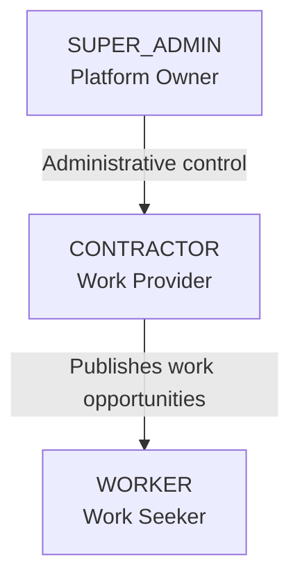
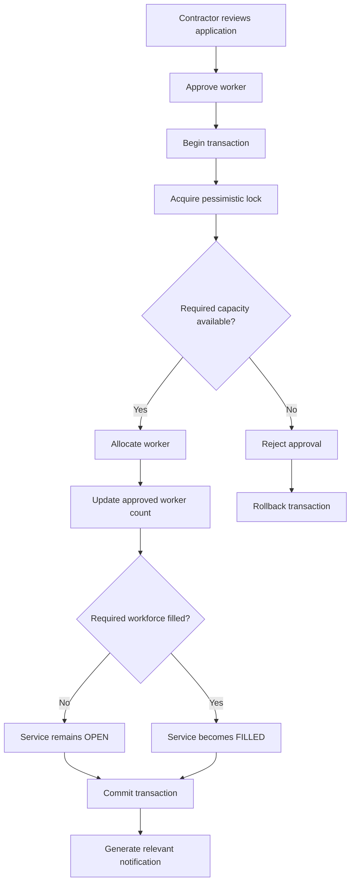
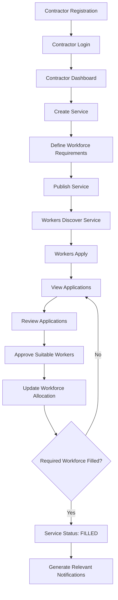
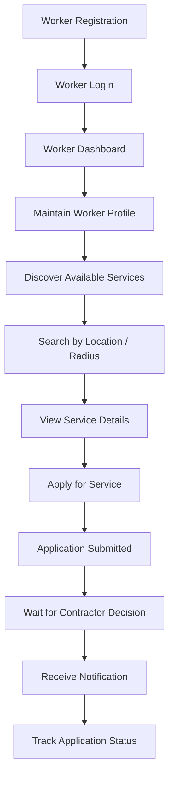
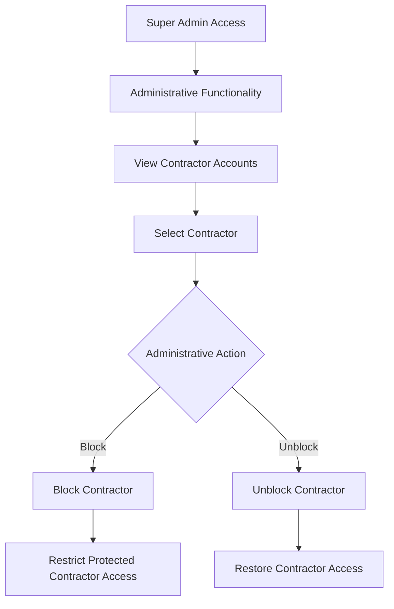
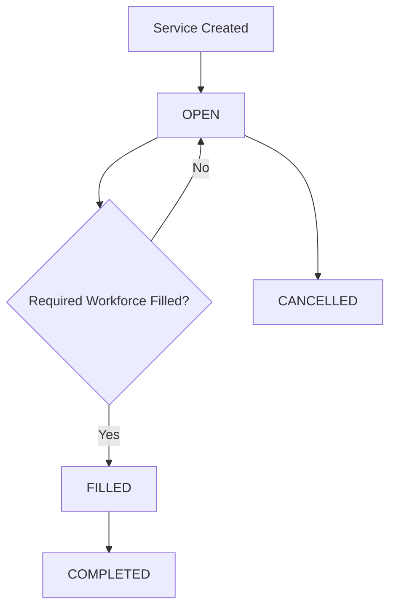
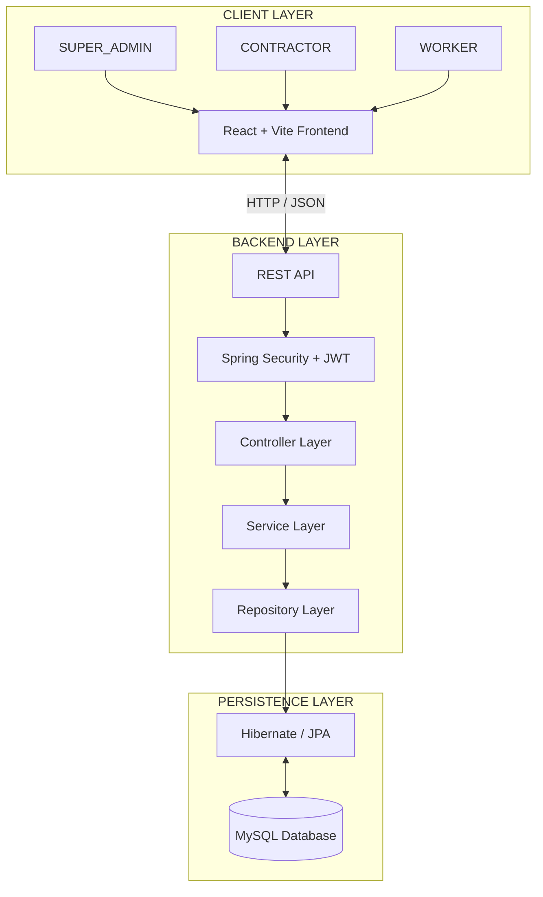
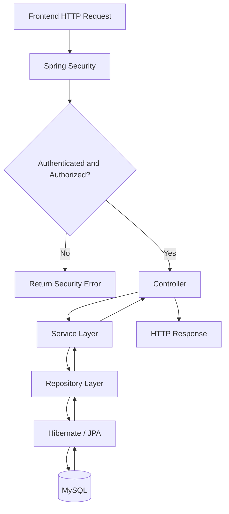
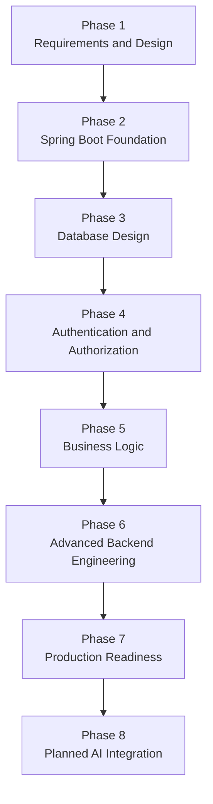

# WorkBridge — Project Overview

| Project Information | Details |
|---|---|
| Project Name | WorkBridge |
| Project Type | Workforce Marketplace Platform |
| Development Approach | Rebuilding the existing application from scratch |
| Backend | Java + Spring Boot |
| Frontend | React + Vite |
| Database | MySQL |
| Architecture | Client-Server Architecture with Layered Backend |
| API Communication | REST APIs |
| Authentication | Spring Security + JWT |
| ORM | Hibernate / Spring Data JPA |

---

# 1. Project Introduction

WorkBridge is a workforce marketplace platform that connects contractors who require temporary workers with workers searching for employment opportunities, particularly for events and related services.

The platform provides a centralized environment where:

- Contractors can publish work opportunities.
- Contractors can specify workforce requirements.
- Workers can discover available services.
- Workers can apply for suitable opportunities.
- Contractors can review applications and approve workers.
- A Super Admin oversees the platform and manages contractor access.

## 1.1 User Roles

WorkBridge consists of three primary user roles.

| Role | Description |
|---|---|
| SUPER_ADMIN | Platform owner who has overall administrative authority. |
| CONTRACTOR | User who publishes work opportunities and recruits workers. |
| WORKER | User who discovers and applies for work opportunities. |

---

# 2. Problem Statement

Finding suitable workers for temporary work and event-related services can be difficult for contractors.

Similarly, workers may struggle to discover temporary employment opportunities and connect with contractors who require their services.

Traditional approaches often involve manual communication, making workforce discovery, application management and worker allocation difficult to coordinate.

WorkBridge addresses these problems by providing a centralized platform that connects contractors and workers and manages their interactions through a structured application workflow.

---

# 3. Project Objectives

| No. | Objective |
|---|---|
| 1 | Provide a centralized platform connecting contractors and workers. |
| 2 | Allow contractors to publish and manage work opportunities. |
| 3 | Allow workers to discover and apply for available services. |
| 4 | Provide application management and worker approval capabilities. |
| 5 | Manage workforce requirements and worker allocation. |
| 6 | Prevent workforce over-allocation during concurrent approvals. |
| 7 | Provide notifications for relevant application activities. |
| 8 | Support location-based service discovery. |
| 9 | Provide payment and payout simulation functionality. |
| 10 | Give the Super Admin administrative control over contractor access. |

---

# 4. User Roles and Responsibilities

## 4.1 SUPER_ADMIN

The Super Admin is the owner and highest-authority administrator of the WorkBridge platform.

The Super Admin is responsible for platform-level administration and controlling contractor access.

| Responsibility | Description |
|---|---|
| Platform Administration | Oversee the WorkBridge platform. |
| Contractor Management | View and manage contractor accounts. |
| Block Contractor | Restrict a contractor's platform access when necessary. |
| Unblock Contractor | Restore access to a previously blocked contractor. |
| Administrative Authority | Exercise platform-level administrative permissions. |

**Security requirement:** Super Admin access must be provisioned securely. Public users must not be able to register themselves as Super Admin.

## 4.2 CONTRACTOR

A contractor is a user who publishes work opportunities and recruits workers through WorkBridge.

| Module | Responsibilities |
|---|---|
| Account Management | Register, log in and access contractor functionality. |
| Service Management | Create, update, delete and retrieve service listings. |
| Workforce Management | Define required workers and monitor approved workforce. |
| Application Management | View, review and approve worker applications. |
| Notifications | Receive and view application-related notifications. |
| Payment and Payout | Use the existing simulated payment and payout workflows. |

## 4.3 WORKER

A worker is a user who discovers available work opportunities and applies for services published by contractors.

| Module | Responsibilities |
|---|---|
| Account Management | Register, log in and maintain worker profile information. |
| Service Discovery | Discover and view available services. |
| Service Search | Search services using geographical radius. |
| Application Management | Apply for services and track application progress. |
| Notifications | Receive and view relevant notifications. |

## 4.4 Role Hierarchy

The Super Admin has platform-level administrative authority. Contractors manage their own services and worker approvals. Workers discover and apply for available opportunities.

---

# 5. Existing Functional Modules

The following modules represent the existing WorkBridge functionality that must be preserved.

## 5.1 Authentication Module

**Purpose:** Manage user registration, login and authentication.

| Feature | Description |
|---|---|
| Contractor Registration | Register contractor accounts. |
| Worker Registration | Register worker accounts. |
| User Login | Authenticate registered users. |
| Password Encryption | Encrypt passwords using BCrypt. |
| JWT Authentication | Generate and validate JWT tokens. |
| Role-Based Authorization | Restrict operations based on user roles. |
| Super Admin Access | Securely provision and authorize the Super Admin role. |

## 5.2 Service Management Module

**Purpose:** Manage work opportunities published by contractors.

| Feature | Description |
|---|---|
| Create Service | Create a new service listing. |
| Update Service | Modify existing service information. |
| Delete Service | Delete service listings. |
| Retrieve Services | Retrieve available service listings. |
| Service Details | View individual service information. |
| Location-Based Search | Search services using geographical location and radius. |
| Workforce Requirements | Define and update the required worker count. |
| Service Status | Maintain the status of each service. |

### Service Information

| Information | Description |
|---|---|
| Contractor Information | Details of the contractor publishing the service. |
| Service Category | Category associated with the service. |
| Required Worker Count | Number of workers required. |
| Service Date and Time | Scheduled service timing. |
| Location Coordinates | Geographical location of the service. |
| Service Status | Current service status. |

## 5.3 Application Management Module

**Purpose:** Manage applications submitted by workers.

| Feature | Description |
|---|---|
| Apply for Service | Workers submit applications. |
| Retrieve Applications | Contractors retrieve applications. |
| Review Applications | Contractors review submitted applications. |
| Approve Applications | Contractors accept suitable workers. |
| Worker Allocation | Approved workers are allocated to services. |
| Application Notifications | Communicate application-related updates. |

The application process must respect the workforce requirements of each service.

## 5.4 Workforce Allocation Module

**Purpose:** Manage the number of workers allocated to a service.

| Feature | Description |
|---|---|
| Required Workforce | Maintain the required worker count. |
| Approved Workforce | Maintain the approved worker count. |
| Worker Allocation | Allocate workers after contractor approval. |
| Workforce Validation | Prevent allocation beyond the required count. |
| Requirement Updates | Handle changes to workforce requirements. |
| Service Reopening | Reopen services when increased requirements create additional vacancies. |
| Concurrency Control | Use transactional processing and pessimistic locking. |

### Workforce Allocation Flowchart

**Important:** Transactional processing and pessimistic database locking are used to prevent concurrent approvals from exceeding the required workforce.

## 5.5 Notification Module

**Purpose:** Communicate relevant application and service-related updates.

| Feature | Description |
|---|---|
| Generate Notification | Generate application-related notifications. |
| Retrieve Notifications | Retrieve notifications. |
| Unread Notifications | Retrieve unread notifications. |
| Read Status | Maintain notification read status. |
| Asynchronous Processing | Handle notifications asynchronously. |

## 5.6 Payment and Payout Module

**Purpose:** Support the existing simulated payment and payout workflows.

| Feature | Description |
|---|---|
| Initiate Payment | Initiate a simulated payment. |
| Confirm Payment | Confirm a simulated payment. |
| Failed Payment | Handle failed payment operations. |
| Process Payout | Process simulated worker payouts. |

**Note:** This module represents the existing mock payment functionality. It does not include a new payment gateway integration.

---

# 6. Main Business Workflows

## 6.1 Contractor Workflow

The contractor workflow describes how contractors publish services and manage worker applications.

## 6.2 Worker Workflow

The worker workflow describes how workers discover and apply for services.

## 6.3 Super Admin Workflow

The Super Admin workflow describes administrative control over contractor accounts.

The exact effects of blocking a contractor on existing services and applications will be specified in the detailed business requirements.

---

# 7. Important Business Rules

The following business rules must be maintained during the rebuild.

| ID | Business Rule |
|---|---|
| BR-01 | Every user must authenticate before accessing protected functionality. |
| BR-02 | Users must only access operations permitted by their assigned roles. |
| BR-03 | Only contractors can create and manage their own service listings. |
| BR-04 | Workers can discover available services. |
| BR-05 | Workers can apply for eligible available services. |
| BR-06 | Contractors control worker approval. |
| BR-07 | Approved worker allocation must respect the required workforce count. |
| BR-08 | Concurrent approval requests must not cause workforce over-allocation. |
| BR-09 | Workforce allocation must be handled transactionally. |
| BR-10 | Service status must reflect workforce availability and service lifecycle. |
| BR-11 | Increasing workforce requirements must allow additional worker applications when applicable. |
| BR-12 | Relevant application activities must generate notifications. |
| BR-13 | Passwords must never be stored as plain text. |
| BR-14 | JWT authentication must protect secured API operations. |
| BR-15 | The Super Admin has authority to block and unblock contractors. |
| BR-16 | A blocked contractor must not be able to use protected contractor operations. |

---

# 8. Service Status

The existing service implementation uses the following statuses.

| Status | Description |
|---|---|
| OPEN | Service is available for worker applications. |
| FILLED | Required workforce has been allocated. |
| CANCELLED | Service has been cancelled. |
| COMPLETED | Service has been completed. |

### Service Status Flowchart

Service status transitions must follow the existing business logic.

---

# 9. Technology Stack

## 9.1 Frontend Technologies

| Technology | Purpose |
|---|---|
| React | Frontend user interface. |
| Vite | Frontend development and build tooling. |
| JavaScript | Frontend application logic. |
| HTML | Application structure. |
| CSS | Application styling. |

## 9.2 Backend Technologies

| Technology | Purpose |
|---|---|
| Java 17 | Backend programming language. |
| Spring Boot | Backend application framework. |
| Spring Security | Authentication and authorization. |
| Spring Data JPA | Database persistence and repository abstraction. |
| Hibernate ORM | ORM implementation. |
| Maven | Dependency and build management. |
| REST APIs | Frontend-backend communication. |
| JWT | Token-based authentication. |
| BCrypt | Password encryption. |

## 9.3 Database Technologies

| Technology | Purpose |
|---|---|
| MySQL | Relational database. |
| JPA | Persistence specification. |
| Hibernate | ORM implementation. |
| Transaction Management | Maintain database consistency. |
| Pessimistic Locking | Control concurrent workforce allocation. |

## 9.4 Development and Deployment Tools

| Tool | Purpose |
|---|---|
| IntelliJ IDEA | Backend development environment. |
| Git | Version control. |
| GitHub | Source code and documentation management. |
| Docker | Application containerization. |
| Maven | Multi-stage Docker build support. |

**Existing implementation reference:** The previous backend used Spring Boot 3.3.2 and Java 17. Exact compatible dependency versions will be established during Phase 2.

---

# 10. High-Level System Architecture

WorkBridge follows a client-server architecture.

The React frontend communicates with the Spring Boot backend through REST APIs.

The Spring Boot backend processes requests, applies security rules, executes business logic and communicates with MySQL.

## 10.1 System Architecture Diagram

## 10.2 Backend Layer Responsibilities

| Layer | Responsibility |
|---|---|
| Controller | Receive HTTP requests, validate request input and return responses. |
| Security | Authenticate users, validate JWT tokens and enforce role-based authorization. |
| Service | Implement business logic and manage transactional operations. |
| Repository | Communicate with the database using Spring Data JPA. |
| Entity | Represent database entities and relationships. |
| DTO | Transfer request and response data between frontend and backend. |
| Exception | Handle application exceptions and provide consistent error responses. |

## 10.3 Backend Request Flow

---

# 11. Existing Domain Entities

The existing implementation contains the following major domain concepts.

| Entity | Responsibility |
|---|---|
| User | Common user and authentication information. |
| WorkerProfile | Worker-specific profile information. |
| ContractorProfile | Contractor-specific profile information. |
| ServiceListing | Work opportunities published by contractors. |
| ServiceCategory | Categories associated with services. |
| Application | Worker applications for services. |
| Notification | Application-related notifications. |
| Payment | Payment simulation records. |
| Payout | Simulated worker payout records. |

The exact entity fields, primary keys, foreign keys, cardinalities and relationships will be documented in the database design phase.

---

# 12. Project Scope and Constraints

## 12.1 Included Functionality

| No. | Functionality |
|---|---|
| 1 | SUPER_ADMIN, CONTRACTOR and WORKER roles. |
| 2 | Authentication and authorization. |
| 3 | Contractor and worker profiles. |
| 4 | Service management. |
| 5 | Service discovery and radius-based search. |
| 6 | Worker applications. |
| 7 | Contractor application approval. |
| 8 | Workforce allocation. |
| 9 | Service status management. |
| 10 | Notifications. |
| 11 | Existing payment and payout simulation. |
| 12 | Transaction management and pessimistic locking. |
| 13 | Docker-based backend deployment. |
| 14 | Super Admin contractor blocking and unblocking. |

## 12.2 Excluded Functionality

| No. | Exclusion |
|---|---|
| 1 | Unrelated new business modules. |
| 2 | Additional user roles. |
| 3 | New marketplace functionality not present in the existing application. |
| 4 | New payment gateway integrations. |
| 5 | Unrequested AI functionality during the initial rebuild. |

## 12.3 Development Principle

**Rebuild existing functionality first. Do not introduce additional features without an explicit requirement.**

---

# 13. Documentation and Development Approach

The project will be developed in the following phases.

| Phase | Description |
|---|---|
| Phase 1 | Requirements, user roles, workflows and system architecture. |
| Phase 2 | Spring Boot project setup, Maven dependencies and configuration. |
| Phase 3 | MySQL database design, entities, relationships and repositories. |
| Phase 4 | Spring Security, JWT, BCrypt and role-based authorization. |
| Phase 5 | Contractor, worker, service, application, notification and payment business logic. |
| Phase 6 | Transactions, pessimistic locking, concurrency and exception handling. |
| Phase 7 | Testing, Docker, deployment and API documentation. |
| Phase 8 | Previously planned LLM and RAG integration. |

All project documentation will be maintained inside the GitHub repository under the `docs/` directory.

---

# 14. Final Project Definition

WorkBridge is a role-based workforce marketplace platform where contractors publish temporary work opportunities, workers discover and apply for those opportunities, and contractors manage applications and workforce allocation.

A Super Admin oversees the platform and controls contractor access.

The platform uses React for the frontend, Spring Boot for backend services, MySQL for data persistence, and JWT-based security for authentication and authorization.

The primary engineering focus is to maintain correct business rules, secure role-based access, consistent workforce allocation and reliable transaction handling while rebuilding the existing application.

**Core principle: Preserve the existing WorkBridge functionality while implementing the agreed Super Admin responsibilities.**