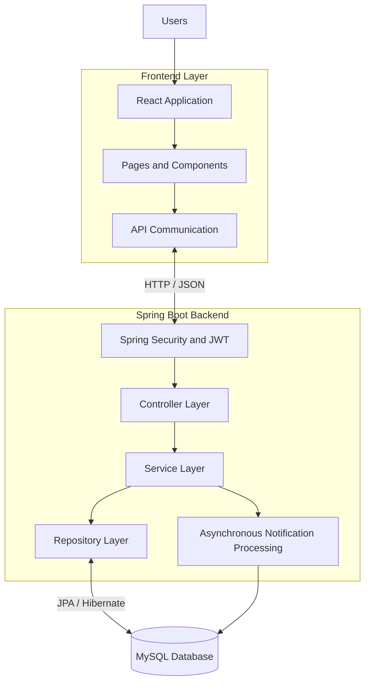
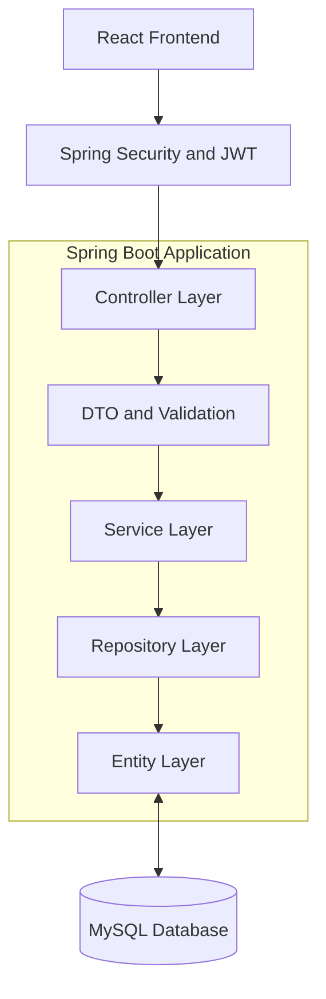
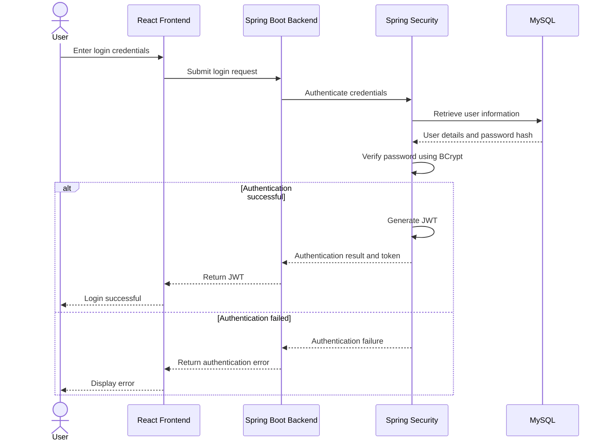
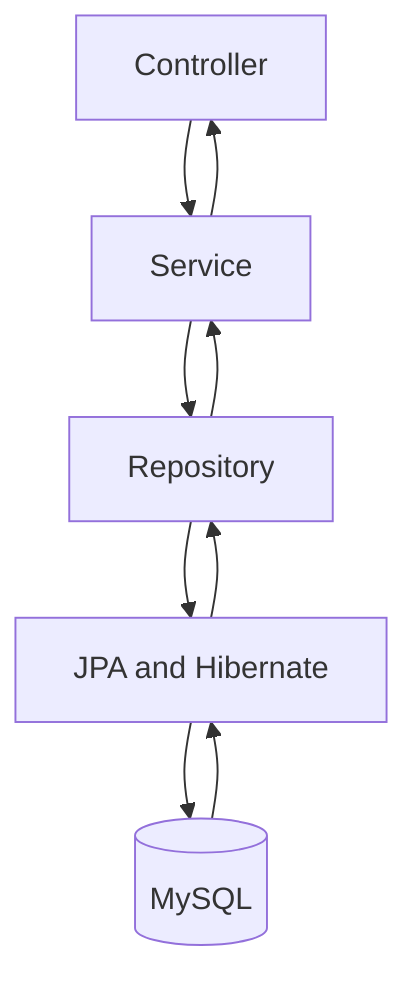
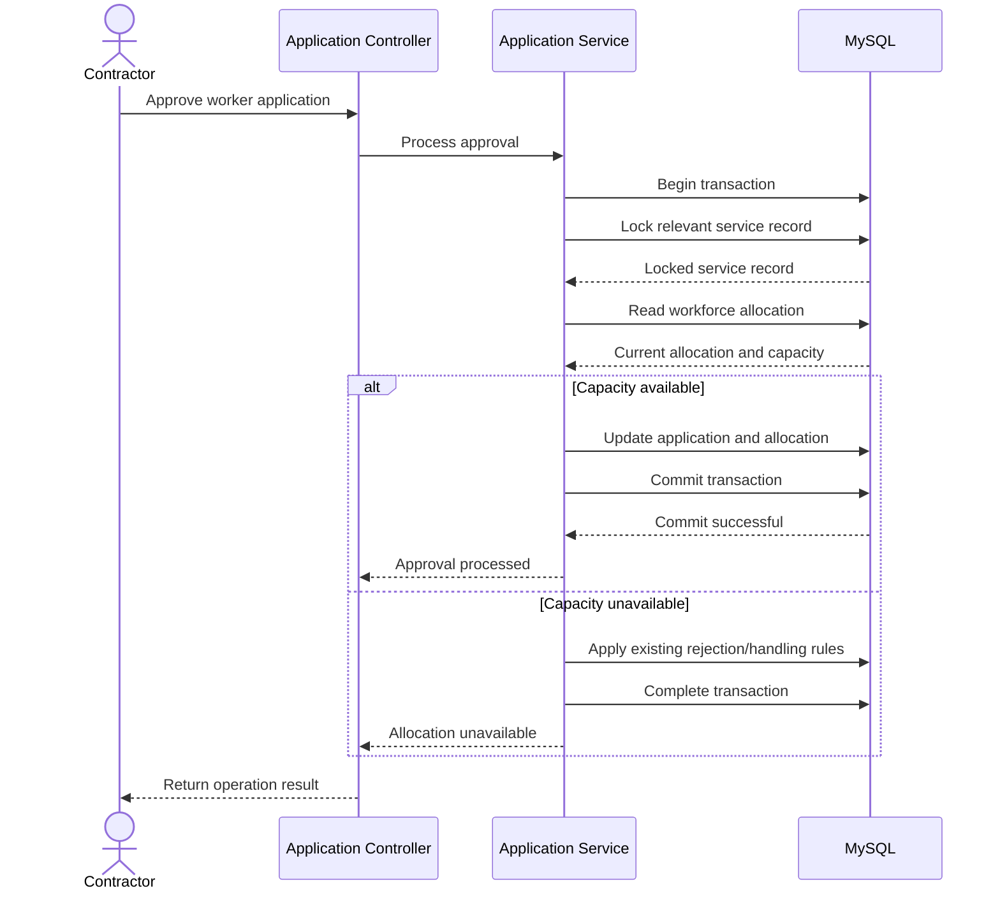
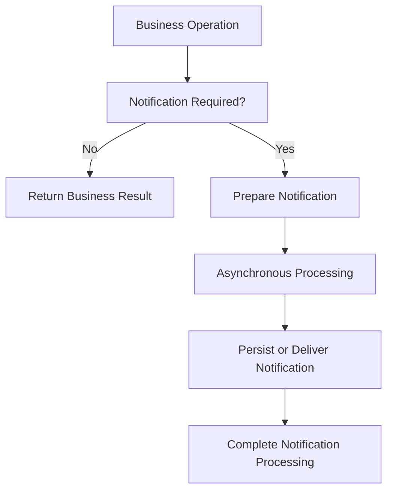
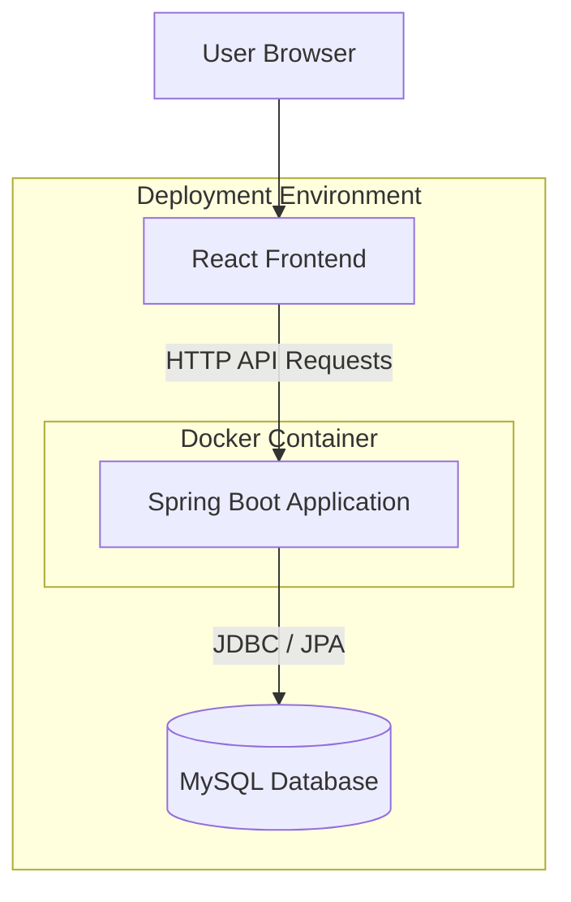
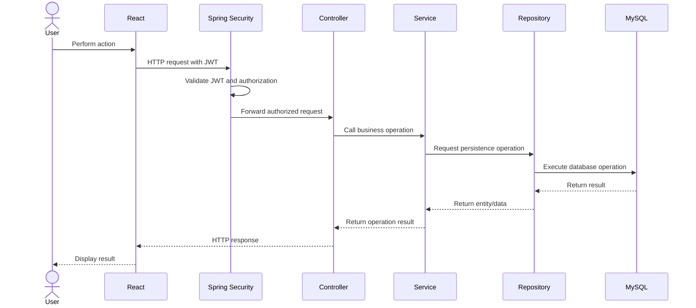

# WorkBridge — System Architecture

## 1. Purpose

This document describes the high-level architecture of the WorkBridge application.

It defines:

- Overall system architecture.
- Frontend and backend responsibilities.
- Backend architectural layers.
- Authentication and authorization flow.
- Database interaction.
- Workforce allocation and concurrency handling.
- Asynchronous notification processing.
- Deployment architecture.
- Communication between application components.

The architecture is based on the existing WorkBridge functionality. It does not introduce additional business features.

---

## 2. Technology Stack

| Layer | Technology | Responsibility |
|---|---|---|
| Frontend | React | User interface |
| Frontend tooling | Vite | Frontend development and build |
| Frontend language | JavaScript | Client-side application logic |
| Backend | Java 17 | Backend programming language |
| Backend framework | Spring Boot | Application development |
| Security | Spring Security | Authentication and authorization |
| Token authentication | JWT | Stateless authentication |
| Password security | BCrypt | Password hashing |
| Persistence | Spring Data JPA / Hibernate | Database persistence and ORM |
| Database | MySQL | Persistent data storage |
| Build tool | Maven | Dependency and build management |
| Containerization | Docker | Backend containerization |

---

## 3. High-Level Architecture

WorkBridge follows a client-server architecture.

The React frontend communicates with the Spring Boot backend through HTTP APIs. The backend processes business operations, applies security and business rules, and interacts with the MySQL database.

### Architecture Diagram



### Architecture Explanation

1. Users interact with the React frontend.
2. React components communicate with backend APIs.
3. Spring Security processes authentication and authorization.
4. Controllers receive and validate incoming requests.
5. Service classes execute business logic.
6. Repositories communicate with MySQL through JPA/Hibernate.
7. Asynchronous notification processing handles relevant notification operations.

---

## 4. Frontend Architecture

### 4.1 Responsibilities

The frontend is responsible for:

- Displaying the WorkBridge user interface.
- Providing registration and login screens.
- Displaying role-specific functionality.
- Allowing contractors to manage services and applications.
- Allowing workers to discover services and submit applications.
- Providing Super Admin contractor management screens.
- Communicating with backend APIs.
- Displaying responses and validation errors.

### 4.2 Frontend Component Structure

The following is a proposed organization for the existing React application. Exact component names can be finalized during implementation.

```text
frontend/
│
├── public/
│
├── src/
│   │
│   ├── assets/
│   │
│   ├── components/
│   │
│   ├── pages/
│   │   ├── auth/
│   │   ├── admin/
│   │   ├── contractor/
│   │   └── worker/
│   │
│   ├── services/
│   │
│   ├── context/
│   │
│   ├── routes/
│   │
│   ├── utils/
│   │
│   ├── App.jsx
│   └── main.jsx
│
├── package.json
└── vite.config.js
```

### 4.3 Frontend Responsibilities by Directory

| Directory | Responsibility |
|---|---|
| components | Reusable UI components |
| pages | Application pages |
| pages/auth | Registration and login screens |
| pages/admin | Super Admin screens |
| pages/contractor | Contractor screens |
| pages/worker | Worker screens |
| services | Backend API communication |
| context | Shared application state, where required |
| routes | Frontend route organization |
| utils | Reusable helper functions |

This is an organizational structure, not a requirement to create every directory immediately.

---

## 5. Backend Architecture

### 5.1 Layered Architecture

The Spring Boot backend will follow a layered architecture.

The main layers are:

1. Controller Layer
2. Service Layer
3. Repository Layer
4. Entity / Model Layer
5. Security Layer

### Backend Architecture Diagram



### 5.2 Controller Layer

**Responsibility:** Handle incoming HTTP requests and return HTTP responses.

Controllers will:

- Expose REST API endpoints.
- Receive request data.
- Perform request-level validation through the application's validation mechanisms.
- Call appropriate service methods.
- Return suitable HTTP responses.

Controllers should not contain complex business logic or direct database operations.

### 5.3 Service Layer

**Responsibility:** Implement WorkBridge business logic.

Examples:

| Service | Responsibility |
|---|---|
| Authentication Service | Registration and authentication |
| User Service | User-related operations |
| Worker Profile Service | Worker profile management |
| Contractor Profile Service | Contractor profile management |
| Service Listing Service | Service creation and management |
| Service Search Service | Service discovery and radius-based search |
| Application Service | Application submission and management |
| Workforce Allocation Service | Worker approval and workforce allocation |
| Notification Service | Notification processing |
| Payment Service | Existing payment simulation |
| Payout Service | Existing payout simulation |

These are logical responsibilities. Exact class boundaries will be decided during implementation.

### 5.4 Repository Layer

**Responsibility:** Handle database operations.

Repositories will use Spring Data JPA to interact with MySQL.

Examples:

- UserRepository
- WorkerProfileRepository
- ContractorProfileRepository
- ServiceListingRepository
- ServiceCategoryRepository
- ApplicationRepository
- NotificationRepository
- PaymentRepository
- PayoutRepository

Repositories should focus on persistence operations rather than business rules.

### 5.5 Entity Layer

**Responsibility:** Represent persistent domain objects.

The existing domain concepts include:

- User
- WorkerProfile
- ContractorProfile
- ServiceListing
- ServiceCategory
- Application
- Notification
- Payment
- Payout

Entity relationships, fields, constraints, and cardinalities will be defined in the database design phase.

---

## 6. Backend Package Structure

The following is the proposed Spring Boot package organization.

```text
backend/
│
├── src/
│   ├── main/
│   │   ├── java/
│   │   │   └── com/workbridge/
│   │   │       │
│   │   │       ├── config/
│   │   │       │
│   │   │       ├── security/
│   │   │       │
│   │   │       ├── controller/
│   │   │       │
│   │   │       ├── service/
│   │   │       │
│   │   │       ├── repository/
│   │   │       │
│   │   │       ├── entity/
│   │   │       │
│   │   │       ├── dto/
│   │   │       │
│   │   │       ├── exception/
│   │   │       │
│   │   │       └── WorkBridgeApplication.java
│   │   │
│   │   └── resources/
│   │       └── application.properties
│   │
│   └── test/
│
└── pom.xml
```

### Package Responsibilities

| Package | Responsibility |
|---|---|
| config | Application configuration |
| security | JWT and Spring Security implementation |
| controller | REST API controllers |
| service | Business logic |
| repository | Database access |
| entity | JPA entity classes |
| dto | Request and response objects |
| exception | Application exception handling |

---

## 7. Authentication and Authorization Architecture

WorkBridge uses JWT-based authentication with Spring Security.

### 7.1 Authentication Flow

1. User submits login credentials.
2. Backend receives the login request.
3. Spring Security authentication mechanisms verify the credentials.
4. Password verification uses BCrypt.
5. On successful authentication, the backend generates a JWT.
6. The token is returned to the frontend.
7. The frontend includes the token in subsequent authenticated API requests.
8. Backend validates the token before allowing protected operations.

### Authentication Diagram



### 7.2 Authorization Flow

Authorization determines which operations a user can perform.

| Role | Access |
|---|---|
| ROLE_SUPER_ADMIN | Super Admin functionality |
| ROLE_CONTRACTOR | Contractor functionality |
| ROLE_WORKER | Worker functionality |

The backend must enforce role-based authorization. Hiding frontend pages alone is not sufficient security.

A contractor's ACTIVE/BLOCKED account state must also be enforced for protected contractor operations.

---

## 8. Database Architecture

MySQL is the persistent storage layer of WorkBridge.

Spring Data JPA and Hibernate provide object-relational mapping between Java entities and database tables.

### Database Interaction



### Existing Domain Concepts

| Domain Concept | Purpose |
|---|---|
| User | Common user account information |
| WorkerProfile | Worker-specific information |
| ContractorProfile | Contractor-specific information |
| ServiceListing | Work opportunity published by a contractor |
| ServiceCategory | Classification of services |
| Application | Worker application for a service |
| Notification | Notification information |
| Payment | Payment simulation information |
| Payout | Payout simulation information |

The exact table structure, foreign keys, relationships, indexes, and constraints will be documented in Phase 3.

---

## 9. Workforce Allocation and Transaction Architecture

Workforce allocation is an important consistency requirement in WorkBridge.

Multiple contractors' approval-related requests may attempt to modify workforce allocation at the same time for a service.

The backend must prevent allocation from exceeding the required workforce capacity.

### Technical Approach

- Spring transaction management.
- Database transaction boundaries.
- Pessimistic locking.
- Capacity validation inside the protected transaction.
- Consistent persistence of application and allocation changes.

### Transaction Flow



**Important:** The exact locking query, isolation behavior, application status transitions, and transaction boundaries must be confirmed against the old implementation before reproducing them.

---

## 10. Asynchronous Notification Architecture

Notification processing is an existing asynchronous responsibility.

It should not unnecessarily delay the main business operation.

### General Processing Flow



The implementation must preserve the existing notification behavior.

The exact asynchronous mechanism, notification triggers, and persistence/delivery approach will be verified from the old source code.

---

## 11. Deployment Architecture

The existing project uses Docker for backend containerization.

The deployment architecture separates the frontend, backend application, and database responsibilities.

### Logical Deployment Diagram



### Deployment Responsibilities

| Component | Responsibility |
|---|---|
| React frontend | Serves the user interface |
| Spring Boot application | Handles APIs and business logic |
| Docker | Packages and runs the backend application |
| MySQL | Stores persistent application data |

The actual production hosting arrangement and network configuration will be documented when the deployment setup is finalized.

---

## 12. End-to-End Request Flow

The following sequence describes a typical authenticated API request.

1. User performs an action in React.
2. Frontend sends an HTTP request to the backend.
3. JWT is supplied for authenticated requests.
4. Spring Security validates authentication and authorization.
5. The controller receives the request.
6. The service layer applies business logic.
7. The repository accesses the database when necessary.
8. The service returns the result.
9. The controller sends the HTTP response.
10. React updates the interface.

### Request Flow Diagram



---

## 13. Architecture Principles

The WorkBridge backend should follow these principles:

| Principle | Application |
|---|---|
| Separation of concerns | Keep controllers, services, repositories, and entities separate. |
| Stateless authentication | Use JWT for authenticated API requests. |
| Role-based authorization | Enforce access according to user roles. |
| Secure password storage | Store password hashes using BCrypt. |
| Transaction management | Protect related database operations. |
| Concurrency control | Prevent workforce over-allocation using pessimistic locking. |
| Asynchronous processing | Preserve asynchronous notification behavior. |
| Persistence abstraction | Use Spring Data JPA for database access. |
| Containerization | Use Docker for backend packaging and execution. |

---

## 14. Architecture Decisions and Verification

| Area | Current Decision / Existing Behavior | Verification |
|---|---|---|
| Frontend | React + Vite | Confirm existing project structure |
| Backend | Spring Boot | Confirm final version during Phase 2 |
| Java | Java 17 | Confirm build configuration |
| Database | MySQL | Confirm database configuration |
| ORM | Spring Data JPA / Hibernate | Confirm dependencies and mappings |
| Authentication | JWT | Verify token implementation |
| Password hashing | BCrypt | Verify configuration |
| Authorization | Role-based security | Verify endpoint permissions |
| Workforce allocation | Transaction + pessimistic locking | Verify existing implementation |
| Notifications | Asynchronous processing | Verify exact mechanism |
| Deployment | Docker | Verify Docker configuration |

---

## 15. Completion Criteria

- [ ] High-level architecture documented.
- [ ] Frontend responsibilities documented.
- [ ] Backend layered architecture documented.
- [ ] Backend package structure documented.
- [ ] Authentication and authorization flows documented.
- [ ] Database interaction documented.
- [ ] Workforce allocation architecture documented.
- [ ] Asynchronous notification architecture documented.
- [ ] Deployment architecture documented.
- [ ] Unverified technical decisions identified.

**End of WorkBridge System Architecture Document**