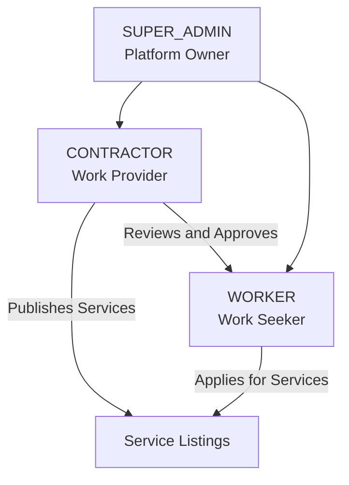
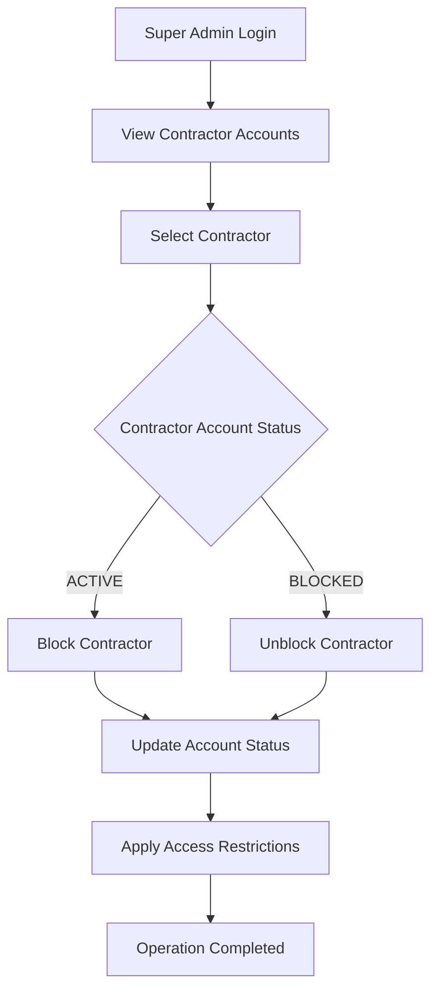
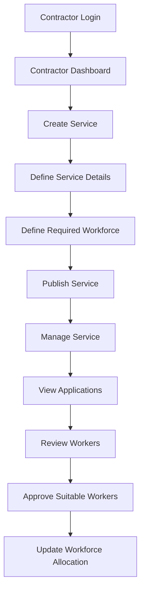
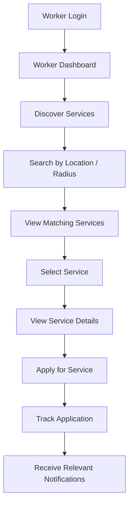
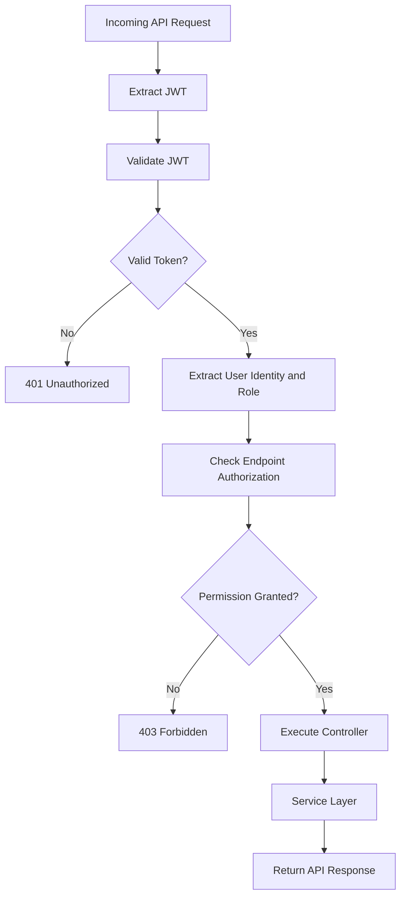
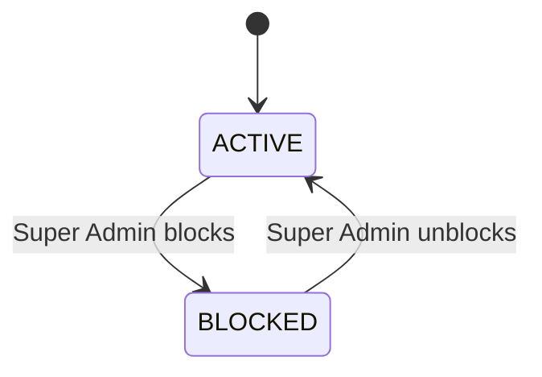

# WorkBridge — User Roles and Permissions

**Document:** User Roles and Permissions  
**Project:** WorkBridge  
**Version:** 1.0  
**Status:** Initial Requirements Documentation

---

# 1. Introduction

WorkBridge is a role-based workforce marketplace application consisting of three primary user roles.

Each role has different responsibilities, permissions and access restrictions.

The three roles are:

1. SUPER_ADMIN
2. CONTRACTOR
3. WORKER

The purpose of this document is to define the responsibilities, authority, permissions and access restrictions associated with each role.

# 2. User Role Overview

| Role | Description | Primary Responsibility |
|---|---|---|
| SUPER_ADMIN | Platform owner | Manage contractor accounts and oversee the platform. |
| CONTRACTOR | Work provider | Publish services and manage workforce applications. |
| WORKER | Work seeker | Discover services and apply for opportunities. |

# 3. Role Hierarchy

The Super Admin has platform-level administrative authority.

Contractors and workers are independent application roles with different business responsibilities.



## 3.1 Role Identifiers

The following role identifiers will be used in Spring Security.

| Role | Spring Security Authority |
|---|---|
| SUPER_ADMIN | ROLE_SUPER_ADMIN |
| CONTRACTOR | ROLE_CONTRACTOR |
| WORKER | ROLE_WORKER |

These role identifiers must remain consistent across the authentication, authorization and backend implementation.

# 4. SUPER_ADMIN — Platform Owner

## 4.1 Role Description

The Super Admin is the owner and highest-authority administrator of WorkBridge.

The Super Admin oversees the platform and has the authority to control contractor access.

There will be no public Super Admin registration.

The Super Admin account must be provisioned securely.

## 4.2 Responsibilities

| ID | Responsibility | Description |
|---|---|---|
| SA-001 | Platform Administration | Oversee the WorkBridge platform. |
| SA-002 | Contractor Management | View and manage contractor accounts. |
| SA-003 | Block Contractor | Restrict contractor access when necessary. |
| SA-004 | Unblock Contractor | Restore access to blocked contractors. |
| SA-005 | Administrative Authority | Perform platform-level administrative operations. |

## 4.3 Super Admin Permissions

| Operation | Permission |
|---|---|
| Super Admin Login | ALLOWED |
| Super Admin Registration | NOT ALLOWED |
| View Contractor Accounts | ALLOWED |
| Block Contractor | ALLOWED |
| Unblock Contractor | ALLOWED |
| Create Services | NOT ALLOWED |
| Approve Worker Applications | NOT ALLOWED |
| Apply for Services | NOT ALLOWED |
| Access Contractor Operations | NOT ALLOWED |
| Access Worker Operations | NOT ALLOWED |

The Super Admin has administrative authority but does not automatically inherit the business responsibilities of contractors or workers.

## 4.4 Contractor Blocking Workflow



## 4.5 Contractor Account Access Rules

| Contractor Status | Expected Behaviour |
|---|---|
| ACTIVE | Contractor can access permitted contractor functionality. |
| BLOCKED | Contractor cannot access protected contractor functionality. |

The blocking operation must be controlled exclusively by the Super Admin.

The effect of blocking on existing services, applications and approved workers will be finalized in the detailed business rules.

# 5. CONTRACTOR — Work Provider

## 5.1 Role Description

A contractor is a registered user who publishes work opportunities and recruits workers through WorkBridge.

Contractors are responsible for creating services, defining workforce requirements and approving suitable workers.

## 5.2 Responsibilities

| ID | Responsibility | Description |
|---|---|---|
| CO-001 | Account Management | Register and log in. |
| CO-002 | Profile Management | Maintain contractor profile information. |
| CO-003 | Service Creation | Publish new service listings. |
| CO-004 | Service Management | Update, delete and retrieve own services. |
| CO-005 | Workforce Management | Define required workforce. |
| CO-006 | Application Management | View and review worker applications. |
| CO-007 | Worker Approval | Approve suitable workers. |
| CO-008 | Workforce Tracking | Monitor required and approved worker counts. |
| CO-009 | Notifications | Retrieve relevant notifications. |
| CO-010 | Payment Operations | Use existing simulated payment and payout functionality. |

## 5.3 Contractor Permissions

| Operation | Permission |
|---|---|
| Contractor Registration | ALLOWED |
| Contractor Login | ALLOWED |
| View Own Profile | ALLOWED |
| Update Own Profile | ALLOWED |
| Create Service | ALLOWED |
| Update Own Service | ALLOWED |
| Delete Own Service | ALLOWED |
| View Own Services | ALLOWED |
| View Worker Applications | ALLOWED |
| Approve Worker Applications | ALLOWED |
| Manage Workforce Requirements | ALLOWED |
| View Notifications | ALLOWED |
| Block Contractors | NOT ALLOWED |
| Unblock Contractors | NOT ALLOWED |
| Access Super Admin Operations | NOT ALLOWED |
| Apply for Own Services | NOT ALLOWED |

## 5.4 Contractor Service Management Workflow



## 5.5 Contractor Access Restrictions

1. Contractors can manage only their own services.
2. Contractors cannot access another contractor's private management operations.
3. Contractors cannot perform Super Admin operations.
4. Contractors cannot approve their own platform-level access.
5. Blocked contractors cannot access protected contractor functionality.

# 6. WORKER — Work Seeker

## 6.1 Role Description

A worker is a registered user who searches for temporary work opportunities and applies for services published by contractors.

Workers are responsible for maintaining their profiles, discovering available services and tracking their applications.

## 6.2 Responsibilities

| ID | Responsibility | Description |
|---|---|---|
| WO-001 | Account Management | Register and log in. |
| WO-002 | Profile Management | Maintain worker profile information. |
| WO-003 | Service Discovery | Discover available services. |
| WO-004 | Service Search | Search services using geographical radius. |
| WO-005 | Service Details | View individual service details. |
| WO-006 | Service Application | Apply for available services. |
| WO-007 | Application Tracking | Track submitted applications. |
| WO-008 | Notifications | Retrieve relevant notifications. |

## 6.3 Worker Permissions

| Operation | Permission |
|---|---|
| Worker Registration | ALLOWED |
| Worker Login | ALLOWED |
| View Own Profile | ALLOWED |
| Update Own Profile | ALLOWED |
| Discover Services | ALLOWED |
| Search Services by Radius | ALLOWED |
| View Service Details | ALLOWED |
| Apply for Services | ALLOWED |
| Track Own Applications | ALLOWED |
| View Notifications | ALLOWED |
| Create Services | NOT ALLOWED |
| Update Contractor Services | NOT ALLOWED |
| Delete Contractor Services | NOT ALLOWED |
| Approve Applications | NOT ALLOWED |
| Manage Workforce Requirements | NOT ALLOWED |
| Block Contractors | NOT ALLOWED |
| Access Super Admin Operations | NOT ALLOWED |

## 6.4 Worker Service Discovery Workflow



## 6.5 Worker Access Restrictions

1. Workers cannot create services.
2. Workers cannot modify contractor service listings.
3. Workers cannot approve applications.
4. Workers cannot manage workforce requirements.
5. Workers cannot perform Super Admin operations.
6. Workers can access their own profile and application information.

# 7. Role-Based Permission Matrix

The following matrix defines the agreed permissions for all three roles.

| Functionality | SUPER_ADMIN | CONTRACTOR | WORKER |
|---|:---:|:---:|:---:|
| Login | YES | YES | YES |
| Public Registration | NO | YES | YES |
| View Own Profile | To be verified | YES | YES |
| Update Own Profile | To be verified | YES | YES |
| View Contractor Accounts | YES | NO | NO |
| Block Contractor | YES | NO | NO |
| Unblock Contractor | YES | NO | NO |
| Create Service | NO | YES | NO |
| Update Own Service | NO | YES | NO |
| Delete Own Service | NO | YES | NO |
| View Own Services | NO | YES | NO |
| Discover Services | NO | NO | YES |
| Radius-Based Search | NO | NO | YES |
| Apply for Service | NO | NO | YES |
| View Applications | NO | YES | NO |
| Approve Applications | NO | YES | NO |
| Manage Workforce | NO | YES | NO |
| View Notifications | To be verified | YES | YES |
| Payment Operations | To be verified | To be verified | To be verified |
| Payout Operations | To be verified | To be verified | To be verified |

**Note:** `To be verified` means the permission must be checked against the original WorkBridge implementation before final authorization rules are established.

# 8. Role-Based Access Control Architecture

WorkBridge will use Spring Security with JWT-based authentication and role-based authorization.

## 8.1 Authorization Flow



## 8.2 Authorization Responsibilities

| Component | Responsibility |
|---|---|
| JWT Filter | Extract and validate JWT tokens. |
| UserDetailsService | Load user authentication information. |
| Security Configuration | Define protected endpoints and role restrictions. |
| Password Encoder | Verify BCrypt-encrypted passwords. |
| Controller | Receive authorized API requests. |
| Service Layer | Enforce business-level ownership and permission rules. |

# 9. Important Security Rules

| ID | Security Rule |
|---|---|
| SEC-001 | Passwords must never be stored as plain text. |
| SEC-002 | JWT must be validated for protected API requests. |
| SEC-003 | Each user must have an appropriate role. |
| SEC-004 | Users cannot access operations belonging to unauthorized roles. |
| SEC-005 | Super Admin registration must not be publicly available. |
| SEC-006 | Only Super Admin can block contractors. |
| SEC-007 | Only Super Admin can unblock contractors. |
| SEC-008 | Blocked contractors cannot access protected contractor operations. |
| SEC-009 | Contractors can manage only their own services. |
| SEC-010 | Workers can access only their own private profile and application information. |
| SEC-011 | Role authorization must be enforced on the backend, not just the frontend. |
| SEC-012 | Ownership validation must be performed for user-specific resources. |

# 10. Role and Account Status Management

The following account states are established for contractor access management.

| Role | Account State | Meaning |
|---|---|---|
| CONTRACTOR | ACTIVE | Contractor has access to permitted contractor functionality. |
| CONTRACTOR | BLOCKED | Contractor access is restricted by the Super Admin. |

The account lifecycle for workers and Super Admin will be specified separately if the existing implementation requires additional states.

## 10.1 Contractor Account State Transition



# 11. Backend Role Implementation Reference

The application will use the following role identifiers.

```java
public enum Role {
    ROLE_SUPER_ADMIN,
    ROLE_CONTRACTOR,
    ROLE_WORKER
}
```

Example authorization concept:

```java
@PreAuthorize("hasRole('SUPER_ADMIN')")
public void blockContractor(Long contractorId) {
    // Super Admin operation
}
```

```java
@PreAuthorize("hasRole('CONTRACTOR')")
public void createService() {
    // Contractor operation
}
```

```java
@PreAuthorize("hasRole('WORKER')")
public void applyForService() {
    // Worker operation
}
```

These are implementation references, not the final application code.

# 12. Requirements and Implementation Mapping

| Requirement Area | Related Development Phase |
|---|---|
| User Roles | Phase 1 — Requirements and Design |
| Role Identifiers | Phase 2 — Spring Boot Foundation |
| User and Role Entities | Phase 3 — Database Design |
| User Authentication | Phase 4 — Authentication and Authorization |
| JWT Authentication | Phase 4 — Authentication and Authorization |
| Role-Based Authorization | Phase 4 — Authentication and Authorization |
| Contractor Blocking | Phase 5 — Business Logic |
| Service Permissions | Phase 5 — Business Logic |
| Worker Application Permissions | Phase 5 — Business Logic |
| Ownership Validation | Phase 5 — Business Logic |

# 13. Final Role Definition

WorkBridge consists of three independent user roles with clearly defined responsibilities.

| Role | Main Authority |
|---|---|
| SUPER_ADMIN | Controls platform administration and contractor access. |
| CONTRACTOR | Manages services, applications and workforce allocation. |
| WORKER | Discovers services and applies for work opportunities. |

The Super Admin is the platform owner and has administrative authority over contractor accounts.

Contractors and workers interact through the service discovery and application workflow.

All operations must be protected through Spring Security, JWT authentication and role-based authorization.

**Core Principle:** Every user must have access only to the operations permitted by their assigned role.

---

**End of User Roles and Permissions Document.**