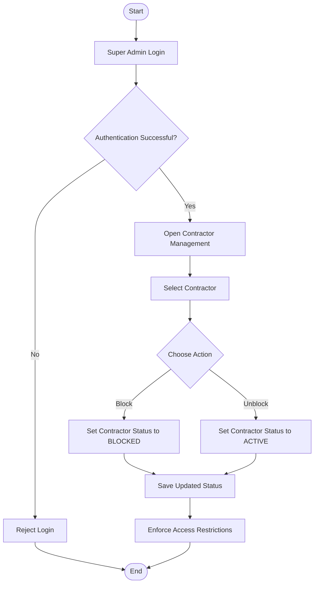
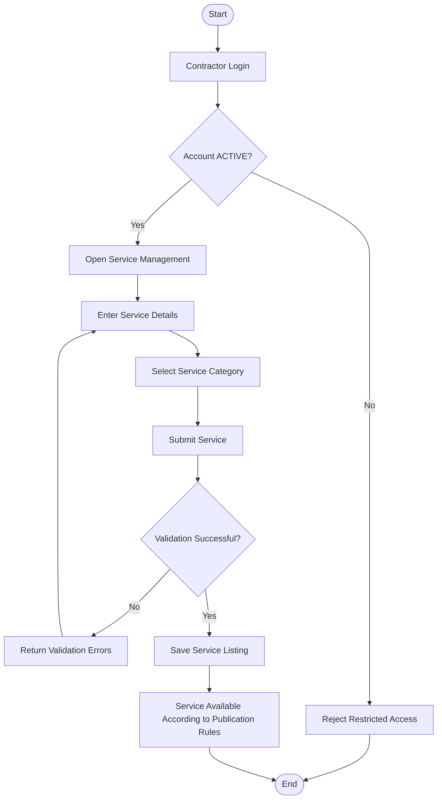
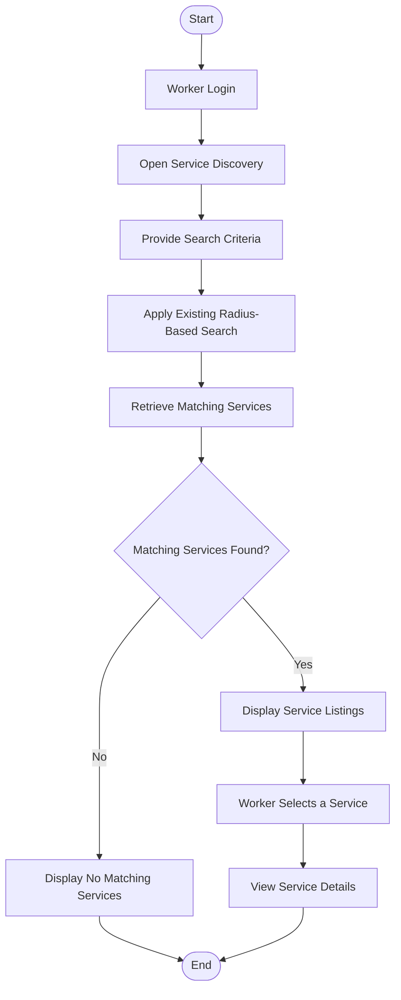
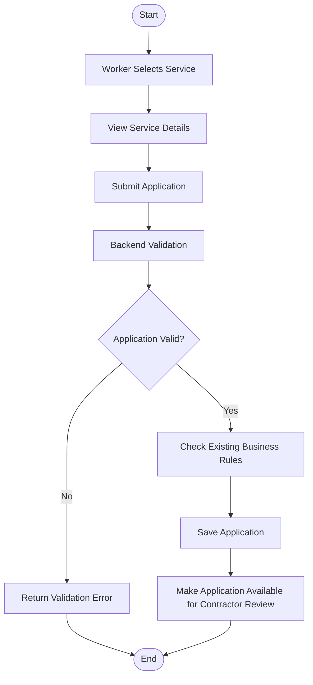
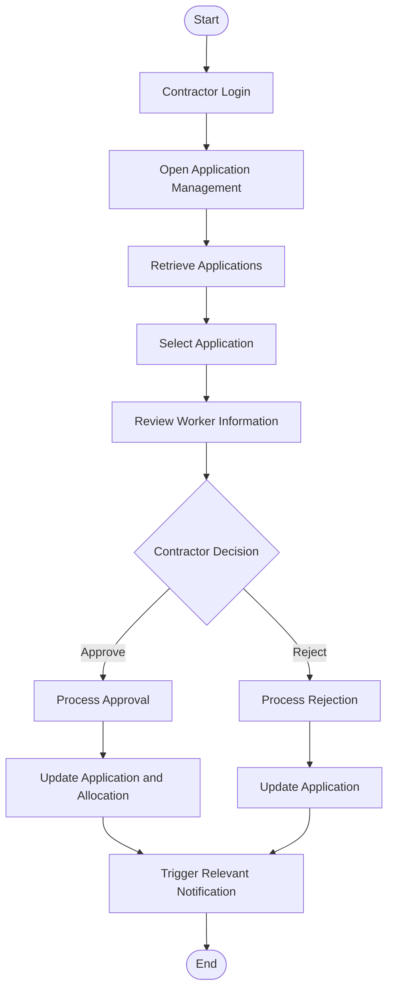
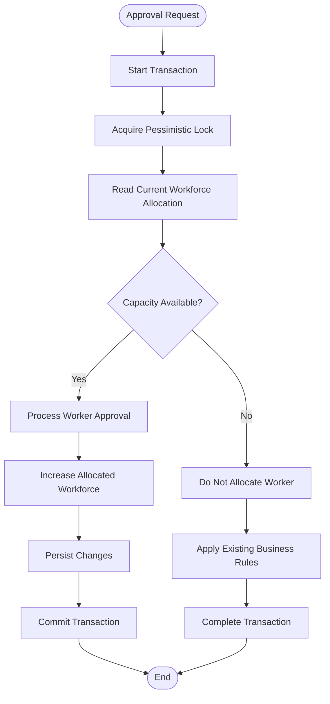
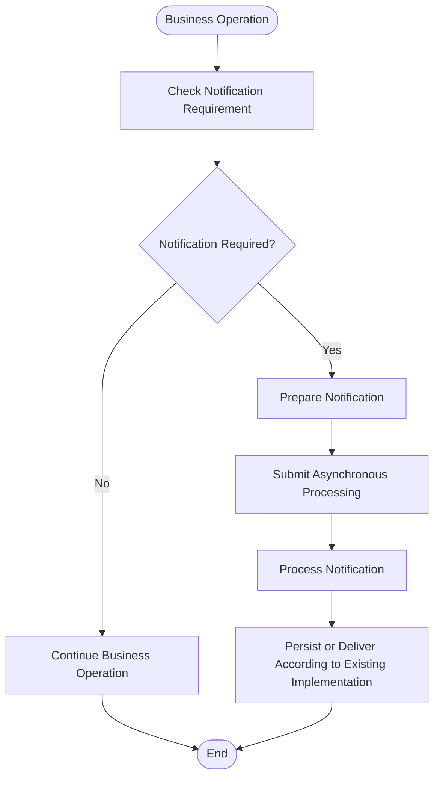
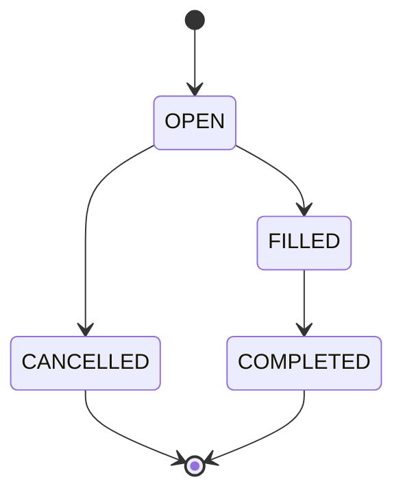
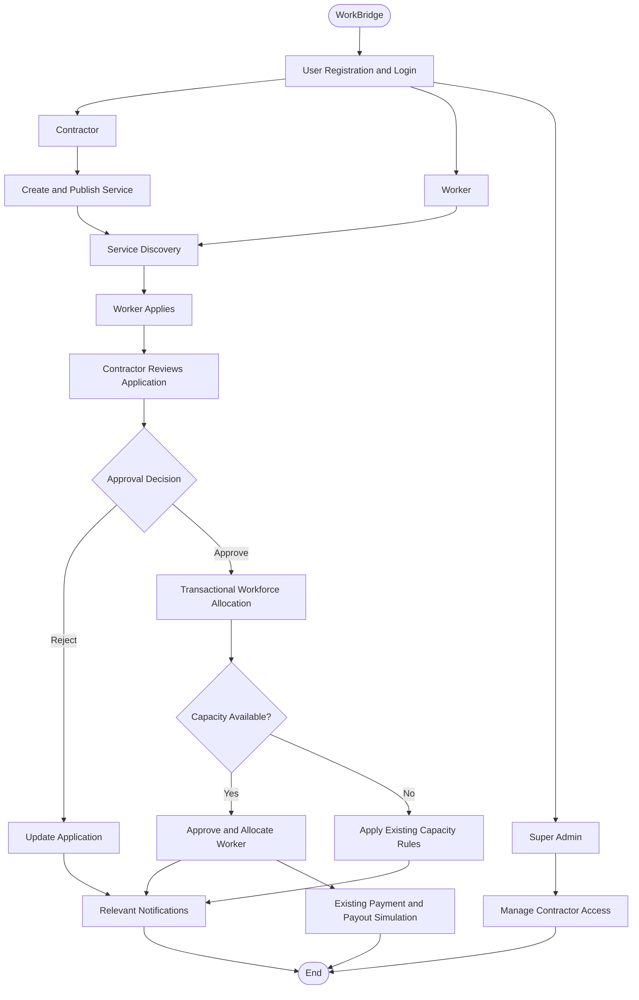

# WorkBridge — Application Workflows

## 1. Purpose

This document describes the end-to-end workflows of the WorkBridge application.

It explains how Super Admins, Contractors, Workers, and the system interact while performing the existing business operations.

The workflows covered are:

1. Super Admin manages contractor access.
2. Contractor account and profile workflow.
3. Worker account and profile workflow.
4. Contractor creates and publishes a service.
5. Worker discovers available services.
6. Worker applies for a service.
7. Contractor reviews applications and approves workers.
8. System allocates workers while preventing over-allocation.
9. System sends notifications.
10. Service lifecycle.
11. Payment and payout simulation.

**Scope restriction:** This document describes existing WorkBridge functionality. It does not introduce new business features. Any behavior that needs confirmation from the previous implementation is explicitly marked as **To Be Verified**.

---

## 2. Actors Involved

| Actor | Description |
|---|---|
| Super Admin | Platform owner who manages contractor access. |
| Contractor | User who publishes work opportunities and manages applications. |
| Worker | User who discovers work opportunities and applies. |
| System | WorkBridge backend responsible for processing requests, enforcing business rules, storing data, and sending notifications. |

---

## 3. Super Admin Workflow

### 3.1 Manage Contractor Access

The Super Admin can manage contractor access by blocking or unblocking contractor accounts.

**Workflow:**

1. Super Admin logs in.
2. System authenticates the Super Admin.
3. Super Admin accesses contractor management.
4. System displays the available contractor information.
5. Super Admin selects a contractor.
6. Super Admin performs either:
    - Block contractor.
    - Unblock contractor.
7. System updates the contractor's account status.
8. System enforces the updated access restrictions.

### Flowchart

### 3.2 Contractor Access Rules

| Contractor Status | Expected Access |
|---|---|
| ACTIVE | Contractor can access permitted contractor functionality. |
| BLOCKED | Contractor cannot access restricted contractor functionality. |

The exact behavior for existing service listings, applications, approved workers, and ongoing payments when a contractor is blocked must be verified against the previous implementation.

---

## 4. Contractor Workflow

### 4.1 Contractor Account and Profile

A contractor uses WorkBridge to publish work opportunities and manage workers.

**Workflow:**

1. Contractor registers an account.
2. System stores the account information.
3. Contractor authenticates.
4. Contractor accesses the contractor profile.
5. Contractor manages the available profile information.
6. Contractor can proceed to create and manage services.

**To Be Verified:**
- Exact registration fields.
- Whether profile creation happens during registration or separately.
- Whether profile editing has any restrictions.

### 4.2 Create and Publish a Service

A contractor creates a service listing describing a work opportunity.

**Workflow:**

1. Contractor logs in.
2. Contractor opens service management.
3. Contractor enters the service information.
4. Contractor selects the relevant service category.
5. Contractor submits the service.
6. Backend validates the submitted information.
7. System stores the service listing.
8. The service becomes available according to the existing publication behavior.

### Flowchart

**To Be Verified:**
- Exact service listing fields.
- Required and optional fields.
- Whether service creation and publication are separate operations.
- Whether a contractor can edit or delete a listing.
- Whether a service requires any additional approval before becoming visible.

---

## 5. Worker Workflow

### 5.1 Worker Account and Profile

Workers use WorkBridge to find and apply for available work opportunities.

**Workflow:**

1. Worker registers an account.
2. System stores the account information.
3. Worker authenticates.
4. Worker accesses the worker profile.
5. Worker manages the available profile information.
6. Worker can discover available services.

**To Be Verified:**
- Exact worker registration fields.
- Exact worker profile fields.
- Whether profile completion is mandatory before applying.

### 5.2 Discover Services

Workers can discover services based on the existing service search functionality, including radius-based search.

**Workflow:**

1. Worker logs in.
2. Worker opens service discovery.
3. Worker provides or uses the available search criteria.
4. System retrieves matching services.
5. System returns the matching service listings.
6. Worker views the available opportunities.
7. Worker selects a service to view its details.

### Flowchart

**To Be Verified:**
- Exact search filters.
- How the search radius is calculated.
- Whether location is obtained from the worker profile or provided during search.
- How services with different lifecycle statuses are filtered.

---

## 6. Worker Application Workflow

### 6.1 Apply for a Service

After discovering a suitable service, a worker can submit an application.

**Workflow:**

1. Worker discovers a service.
2. Worker opens the service details.
3. Worker chooses to apply.
4. Backend validates the application request.
5. System checks the existing application and service business rules.
6. System stores the application.
7. Application becomes available for contractor review.

### Flowchart

**To Be Verified:**
- Exact application status values.
- Whether duplicate applications are prevented.
- Whether workers can withdraw applications.
- Whether workers can apply to a service after its workforce has been filled.
- Whether any additional eligibility conditions exist.

---

## 7. Contractor Application Management Workflow

### 7.1 Review Applications

Contractors review applications submitted by workers for their services.

**Workflow:**

1. Contractor logs in.
2. Contractor opens application management.
3. System retrieves applications associated with the contractor's services.
4. Contractor selects an application.
5. Contractor reviews the worker and application information.
6. Contractor decides whether to approve or reject the application.
7. System processes the selected action according to the existing business rules.

### Flowchart

**Important:** The exact application status names and the precise rejection behavior must be recovered from the previous implementation. Do not introduce new status values during the rebuild without confirming them.

---

## 8. Workforce Allocation Workflow

### 8.1 Why Workforce Allocation Matters

A service can have a required workforce capacity.

When multiple workers apply, contractors may approve applications. The backend must ensure that concurrent approval requests do not allocate more workers than the service requires.

The previous WorkBridge implementation used:

- Database transactions.
- Pessimistic locking.
- Controlled workforce allocation.

These are important existing engineering behaviors that must be preserved.

### 8.2 Allocation Process

1. Contractor approves a worker's application.
2. Backend starts a database transaction.
3. Backend obtains the required pessimistic lock on the relevant service record.
4. Backend reads the current workforce allocation.
5. Backend checks the available capacity.
6. If capacity is available:
    - Process the approval.
    - Update the allocation.
    - Persist the changes.
7. If capacity is unavailable:
    - Do not allocate an additional worker.
    - Process the request according to the existing business rules.
8. Transaction completes.

### Flowchart

### 8.3 Allocation Business Rules

| Rule ID | Business Rule |
|---|---|
| ALLOC-001 | Worker approval must respect the service's workforce capacity. |
| ALLOC-002 | Concurrent approval requests must not result in over-allocation. |
| ALLOC-003 | Allocation-related database operations must execute transactionally. |
| ALLOC-004 | Pessimistic locking must protect the relevant allocation operation. |
| ALLOC-005 | Allocation changes must be persisted consistently with the application approval. |

**Important implementation requirement:** The application approval and workforce allocation must not become inconsistent if an operation fails. The transaction boundary must protect the related database changes.

---

## 9. Notification Workflow

WorkBridge includes a notification mechanism for relevant application activities.

The notification processing was designed to be asynchronous.

### General Workflow

1. An existing business operation takes place.
2. Backend identifies whether that operation requires a notification.
3. The notification is prepared.
4. Notification processing is performed asynchronously.
5. The notification is stored or delivered according to the existing implementation.

### Flowchart

**To Be Verified:**
- Exact notification triggers.
- Which role receives each notification.
- Notification fields and types.
- Whether notifications are stored in the database, delivered externally, or both.
- Whether notification processing uses Spring's asynchronous execution support or another mechanism.

---

## 10. Service Lifecycle Workflow

The existing service lifecycle uses these statuses:

| Status | Meaning |
|---|---|
| OPEN | Service is open for the existing discovery and application process. |
| FILLED | Workforce requirement has been filled. |
| CANCELLED | Service has been cancelled. |
| COMPLETED | Service has been completed. |

### Lifecycle Diagram

**Note:** This diagram captures the known lifecycle statuses and broad transitions. Exact transition conditions, whether additional transitions exist, and whether transitions are automatic or contractor-controlled must be verified against the old implementation.

---

## 11. Payment and Payout Simulation Workflow

WorkBridge contains payment and payout simulation functionality.

The rebuild must preserve the existing simulation behavior rather than introduce a new payment gateway or real-money transaction workflow.

### General Workflow

1. An existing business event reaches the payment or payout stage.
2. Backend processes the relevant payment or payout operation.
3. System records the result according to the existing implementation.
4. Relevant status or transaction information is retained.

### Important Verification Points

| Area | Details to Verify |
|---|---|
| Payment | Exact trigger and creation workflow. |
| Payout | Exact trigger and creation workflow. |
| Relationships | How payments and payouts relate to services, contractors, and workers. |
| Statuses | Existing payment and payout status values. |
| Authorization | Which role can initiate or view each operation. |
| Simulation | How the existing implementation represents success and failure. |

Do not assume that payment and payout are triggered automatically when a service becomes FILLED or COMPLETED. Verify the original implementation first.

---

## 12. Combined WorkBridge Business Flow

The following diagram connects the major existing workflows.

---

## 13. Workflow-to-Module Mapping

| Workflow | Main Backend Responsibility |
|---|---|
| Super Admin management | User management and contractor access control |
| Contractor account | Authentication and contractor profile |
| Worker account | Authentication and worker profile |
| Service creation | Service management |
| Service discovery | Service search and radius-based filtering |
| Worker application | Application management |
| Contractor review | Application management |
| Workforce allocation | Transaction management and concurrency control |
| Notifications | Asynchronous notification processing |
| Service lifecycle | Service status management |
| Payment simulation | Payment management |
| Payout simulation | Payout management |

---

## 14. Important Items to Verify Against the Previous Implementation

Before finalizing the workflows and implementing them in Spring Boot, verify the following from the old source code:

1. Exact contractor and worker registration fields.
2. Exact contractor and worker profile fields.
3. Exact service listing fields.
4. Exact application status values and transitions.
5. Duplicate application handling.
6. Worker application withdrawal behavior, if supported.
7. Exact radius-based search calculation and filters.
8. Exact workforce allocation implementation and locking strategy.
9. Contractor blocking behavior for existing services and applications.
10. Exact notification triggers and recipients.
11. Payment and payout simulation logic.
12. Service status transition conditions.

These details should be recovered from the existing implementation rather than guessed.

---

## 15. Completion Criteria

The workflow documentation is complete when:

- [ ] Super Admin workflow is documented.
- [ ] Contractor workflow is documented.
- [ ] Worker workflow is documented.
- [ ] Service creation and discovery workflows are documented.
- [ ] Application submission and review workflows are documented.
- [ ] Workforce allocation and concurrency protection are documented.
- [ ] Notification workflow is documented.
- [ ] Service lifecycle is documented.
- [ ] Payment and payout simulation are documented.
- [ ] Unverified behavior is identified for source-code review.

**End of WorkBridge Application Workflows Document**