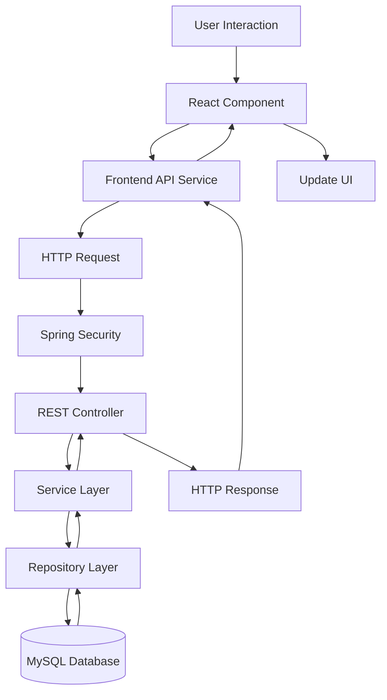
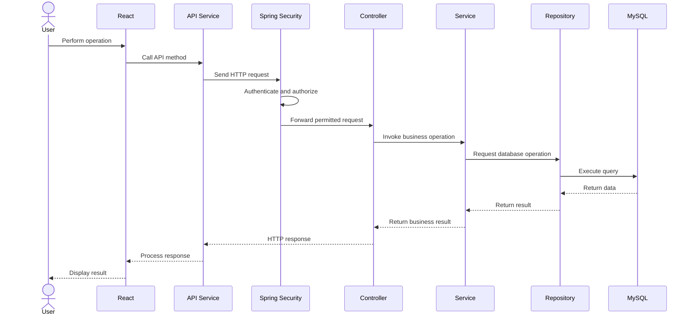
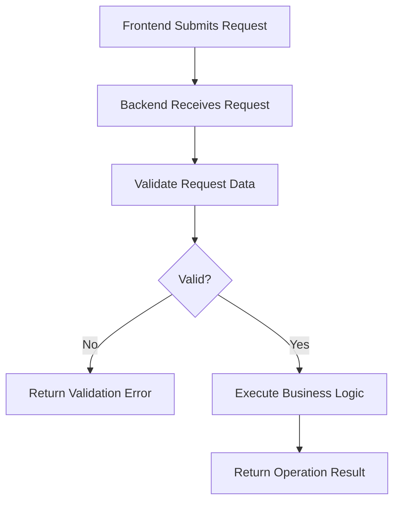
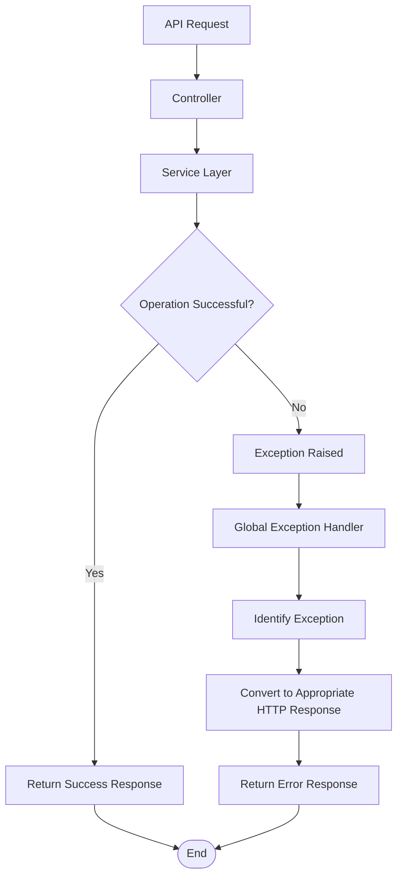

# WorkBridge — API Communication and Exception Handling Architecture

## 1. Purpose

This document defines the communication architecture between the React frontend and Spring Boot backend.

It also describes how the backend validates requests, handles exceptions, and returns responses.

The objectives are:

- Establish consistent frontend-backend communication.
- Define the REST API request lifecycle.
- Document request and response responsibilities.
- Define authentication handling for API requests.
- Establish centralized exception handling.
- Prevent internal errors from being exposed to users.

This document describes the technical architecture. Exact endpoint URLs and response formats will be documented separately in `04-API`.

---

## 2. Communication Architecture

WorkBridge follows a REST-based client-server communication model.

| Component | Responsibility |
|---|---|
| React frontend | Initiates API requests and displays results |
| HTTP client | Sends requests to backend endpoints |
| Spring Security | Handles authentication and authorization |
| Controller | Receives HTTP requests |
| Service | Executes business logic |
| Repository | Performs database operations |
| MySQL | Stores application data |

### Communication diagram



---

## 3. REST API Communication

The frontend communicates with the backend using HTTP methods.

| HTTP Method | General Purpose | WorkBridge Example |
|---|---|---|
| GET | Retrieve information | Retrieve available services |
| POST | Create or submit information | Submit a worker application |
| PUT | Update an existing resource | Update profile information |
| PATCH | Partially update a resource | Change contractor account status, if supported by the existing API |
| DELETE | Delete a resource | Only where deletion is supported by existing functionality |

The actual HTTP method for each operation must be confirmed when the API endpoints are implemented.

---

## 4. Request Processing Lifecycle

Every backend request follows a defined processing sequence.

1. User performs an action in the frontend.
2. React calls the appropriate API service.
3. Frontend constructs the HTTP request.
4. JWT is included when authentication is required.
5. Spring Security processes authentication and authorization.
6. The request reaches the appropriate controller.
7. Controller passes the operation to the service layer.
8. Service executes business rules.
9. Repository performs required database operations.
10. Controller returns the HTTP response.
11. Frontend processes the response and updates the interface.

### Request lifecycle diagram



---

## 5. Request and Response Responsibilities

### 5.1 Request Responsibilities

The frontend is responsible for sending the required request data.

The backend is responsible for:

- Validating incoming data.
- Checking authentication.
- Checking authorization.
- Applying business rules.
- Processing database operations.
- Returning appropriate responses.

### 5.2 Response Responsibilities

The backend should return:

- Appropriate HTTP status codes.
- Requested data for successful retrieval operations.
- Confirmation or result information for successful operations.
- Validation details for invalid requests.
- Appropriate error information when operations fail.

The exact JSON response structure will be finalized in the API documentation.

---

## 6. JWT in API Communication

Authenticated requests use JWT-based authentication.

The frontend sends the token using the HTTP Authorization header.

Example:

```http
GET /api/services
Authorization: Bearer <JWT_TOKEN>
```

### Authentication handling

| Scenario | Expected Backend Behavior |
|---|---|
| Valid token | Process request after authorization checks |
| Missing token on protected endpoint | Reject authentication |
| Invalid token | Reject authentication |
| Expired token | Reject authentication |
| Valid token but insufficient role | Reject authorization |

The exact public and protected endpoints will be defined in the API documentation.

---

## 7. Input Validation Architecture

Request validation prevents invalid data from reaching business operations.

Validation responsibilities are divided between frontend and backend.

### Frontend validation

- Provides immediate user feedback.
- Checks basic input requirements.
- Helps prevent incomplete form submission.

### Backend validation

- Performs authoritative request validation.
- Rejects invalid input even when frontend validation is bypassed.
- Prevents invalid data from reaching business operations.

### Validation flow



Spring Boot Bean Validation can be used for request validation.

Examples of validation annotations include:

| Annotation | Purpose |
|---|---|
| `@NotNull` | Value must not be null |
| `@NotBlank` | String must not be null or blank |
| `@NotEmpty` | Collection or string must not be empty |
| `@Size` | Restrict length or collection size |
| `@Email` | Validate email format |
| `@Min` | Define minimum numeric value |
| `@Max` | Define maximum numeric value |

The actual validation rules must match the existing WorkBridge requirements.

---

## 8. Exception Handling Architecture

Exception handling ensures that failures are processed consistently.

The backend should avoid exposing internal implementation details, database credentials, SQL statements, or stack traces in API responses.

### Exception handling responsibilities

| Component | Responsibility |
|---|---|
| Service layer | Raise or propagate business-related exceptions |
| Controller layer | Delegate request processing |
| Global exception handler | Convert exceptions into HTTP responses |
| Frontend | Display appropriate error feedback |

### Centralized exception handling

Spring Boot provides `@RestControllerAdvice` for centralized REST exception handling.

The global exception handler can process:

- Request validation exceptions.
- Resource-not-found exceptions.
- Business-rule exceptions.
- Authentication and authorization errors where applicable.
- Unexpected internal exceptions.

### Exception flowchart



---

## 9. HTTP Status Code Strategy

The following status codes provide the initial response strategy.

| Status Code | Meaning | Example |
|---|---|---|
| 200 | OK | Successful retrieval or update |
| 201 | Created | Resource successfully created |
| 204 | No Content | Successful operation with no response body |
| 400 | Bad Request | Invalid request data |
| 401 | Unauthorized | Missing or invalid authentication |
| 403 | Forbidden | Insufficient permissions |
| 404 | Not Found | Requested resource does not exist |
| 409 | Conflict | Business or resource state conflict |
| 500 | Internal Server Error | Unexpected backend failure |

The exact status code for each business operation will be finalized during API implementation.

---

## 10. Error Response Structure

WorkBridge should use a consistent error response structure.

Proposed example:

```json
{
  "timestamp": "2026-11-05T10:30:00",
  "status": 400,
  "error": "Bad Request",
  "message": "Request validation failed",
  "path": "/api/example"
}
```

This is a proposed response structure, not a claim about the previous implementation.

For validation failures, the response may also include field-level error details.

Example:

```json
{
  "timestamp": "2026-11-05T10:30:00",
  "status": 400,
  "error": "Validation Failed",
  "message": "Invalid request data",
  "fieldErrors": {
    "email": "Invalid email format",
    "name": "Name must not be blank"
  }
}
```

The final response format will be standardized before implementing the API layer.

---

## 11. Exception Categories

| Exception Category | Description | Expected Handling |
|---|---|---|
| Validation exception | Request contains invalid data | Return 400 |
| Authentication exception | User cannot be authenticated | Return 401 |
| Authorization exception | User lacks required permissions | Return 403 |
| Resource-not-found exception | Requested resource does not exist | Return 404 |
| Business-rule exception | Operation violates business rules | Return appropriate business error |
| Conflict exception | Operation conflicts with current resource state | Return 409 where applicable |
| Unexpected exception | Unhandled application failure | Return 500 |

Business exceptions must reflect actual WorkBridge rules rather than introducing new business restrictions.

---

## 12. Frontend Error Handling

The React frontend must process backend responses appropriately.

Examples:

| Backend Response | Frontend Responsibility |
|---|---|
| 200 / 201 | Display or update successful result |
| 400 | Display validation feedback |
| 401 | Handle unauthenticated state |
| 403 | Display access-denied feedback |
| 404 | Display resource-not-found feedback |
| 409 | Display operation conflict feedback |
| 500 | Display a general error message |

The frontend must not assume that every request succeeds.

---

## 13. Logging and Error Security

The backend should maintain useful application logs for debugging and maintenance.

Logging guidelines:

1. Record relevant application failures.
2. Include useful exception context.
3. Avoid logging plain-text passwords.
4. Avoid logging JWT secrets.
5. Avoid exposing stack traces in API responses.
6. Avoid logging unnecessary sensitive user information.
7. Keep error responses separate from internal diagnostic details.

---

## 14. Implementation Components

The following components will support this architecture.

| Component | Responsibility |
|---|---|
| REST Controllers | Handle HTTP requests |
| Request DTOs | Represent incoming request data |
| Response DTOs | Represent outgoing response data |
| Validation annotations | Validate request data |
| Global Exception Handler | Centralize REST exception handling |
| Custom Business Exceptions | Represent existing business-rule failures |
| Frontend API Services | Communicate with backend endpoints |
| Frontend Error Handling | Process API failures and display feedback |

Exact class names and endpoint definitions will be finalized during implementation.

---

## 15. Completion Criteria

- [ ] Frontend-backend communication documented.
- [ ] REST request lifecycle documented.
- [ ] HTTP method responsibilities documented.
- [ ] JWT request handling documented.
- [ ] Request validation architecture documented.
- [ ] Centralized exception handling documented.
- [ ] HTTP response strategy documented.
- [ ] Error response structure documented.
- [ ] Frontend error handling documented.
- [ ] Security-conscious logging documented.

**End of WorkBridge API Communication and Exception Handling Architecture Document**