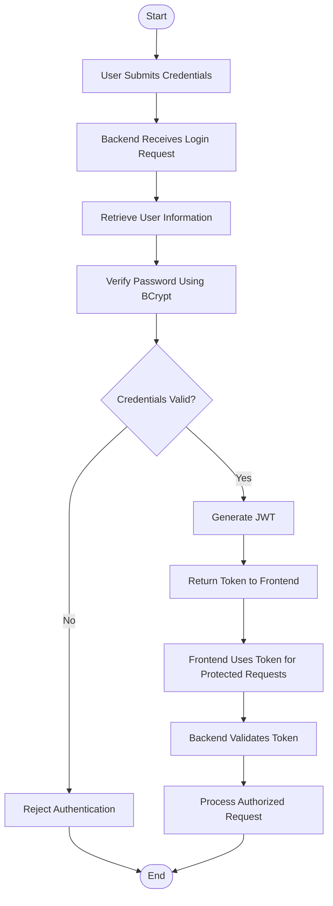
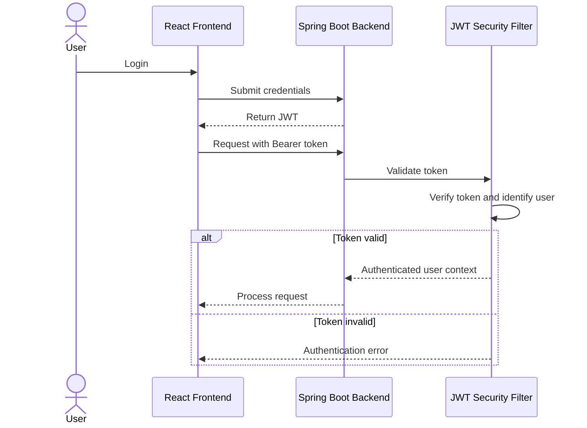
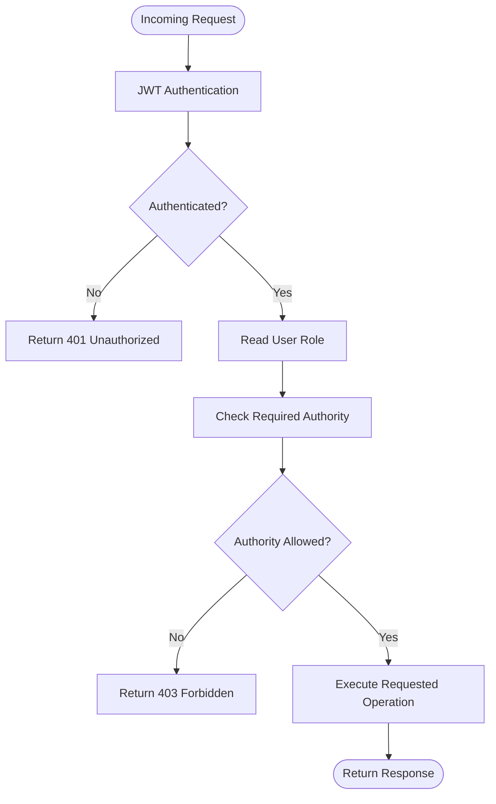
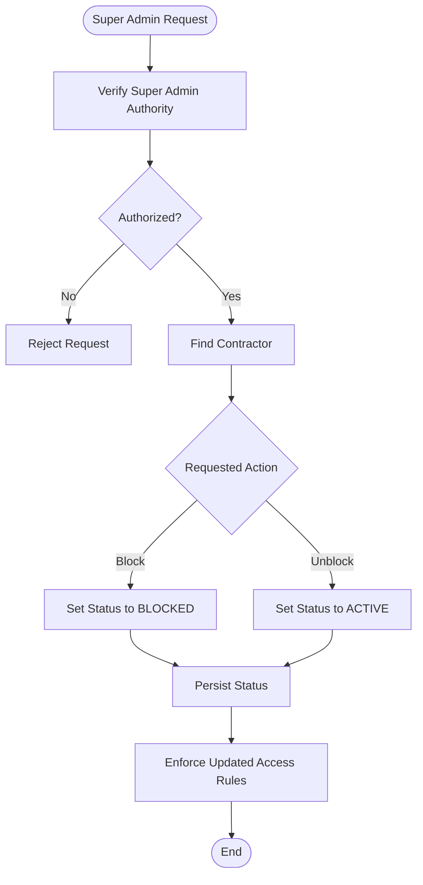

# WorkBridge — Security Architecture

## 1. Purpose

This document defines the security architecture of WorkBridge.

It describes how users authenticate, how the backend identifies users, how role-based authorization works, and how contractor blocking is enforced.

The security design must preserve the existing WorkBridge functionality.

## 2. Security Requirements

WorkBridge has three application roles:

| Role | Authority | Responsibility |
|---|---|---|
| Super Admin | ROLE_SUPER_ADMIN | Manage contractor access |
| Contractor | ROLE_CONTRACTOR | Manage contractor functionality |
| Worker | ROLE_WORKER | Access worker functionality |

The backend must enforce access permissions independently of frontend restrictions.

## 3. Authentication Architecture

WorkBridge uses JWT-based authentication.

Authentication verifies the identity of a user before allowing access to protected backend resources.

### Authentication workflow

1. User submits login credentials.
2. Backend receives the authentication request.
3. Spring Security processes authentication.
4. Backend retrieves the corresponding user information.
5. BCrypt verifies the submitted password against the stored password hash.
6. If credentials are valid, the backend generates a JWT.
7. The token is returned to the frontend.
8. The frontend supplies the token with subsequent authenticated requests.
9. Backend validates the token before processing protected requests.

### Authentication flowchart

## 4. Password Security

WorkBridge uses BCrypt for password hashing.

Passwords must not be stored as plain text.

### Password registration workflow

1. User submits registration information.
2. Backend receives the password.
3. BCrypt generates a password hash.
4. Backend stores the hash in the database.
5. The original plain-text password is not stored.

### Password login workflow

1. User submits login credentials.
2. Backend retrieves the stored password hash.
3. BCrypt verifies the submitted password.
4. Authentication succeeds or fails based on verification.

**Security rule:** Never return password hashes in API responses.

## 5. JWT Architecture

JWT is used to maintain authenticated user identity across API requests.

### JWT request flow

### Token responsibilities

| Responsibility | Description |
|---|---|
| Token generation | Generate a JWT after successful authentication. |
| Token validation | Verify the token on protected requests. |
| User identification | Identify the authenticated user. |
| Role identification | Obtain the user's authority for authorization. |
| Token expiration | Reject expired tokens. |

### Token configuration to verify

The following details must be established during implementation:

- JWT signing algorithm.
- Token expiration duration.
- Secret-key management.
- Required token claims.
- Token storage and transmission strategy on the frontend.
- Behavior when a token expires.

These details must not be guessed from the existing high-level requirements.

## 6. Authorization Architecture

Authentication answers:

**Who is the user?**

Authorization answers:

**What is the user allowed to do?**

WorkBridge uses role-based authorization through Spring Security.

### Role-based access matrix

| Functionality | Super Admin | Contractor | Worker |
|---|---|---|---|
| Super Admin management | Yes | No | No |
| Contractor access management | Yes | No | No |
| Contractor profile operations | No | Yes | No |
| Service management | No | Yes | No |
| Application management | No | Yes | No |
| Worker profile operations | No | No | Yes |
| Service discovery | No | No | Yes |
| Submit applications | No | No | Yes |

The table represents the established role boundaries. Exact permissions for individual API operations must be finalized against the existing implementation.

### Authorization flow

## 7. Contractor Account Blocking

Super Admin can block and unblock contractor accounts.

The contractor account has the following established states:

| Status | Description |
|---|---|
| ACTIVE | Contractor account is active. |
| BLOCKED | Contractor account is blocked by Super Admin. |

### Blocking workflow

1. Super Admin authenticates.
2. Super Admin selects a contractor.
3. Super Admin requests the block operation.
4. Backend verifies Super Admin authority.
5. Backend updates the contractor account status to BLOCKED.
6. Backend enforces the applicable contractor access restrictions.

### Unblocking workflow

1. Super Admin authenticates.
2. Super Admin selects a blocked contractor.
3. Super Admin requests the unblock operation.
4. Backend verifies Super Admin authority.
5. Backend updates the contractor account status to ACTIVE.
6. Contractor access is restored according to the existing authorization rules.

### Blocking flowchart

### Important behavior to verify

The previous implementation must be inspected to establish:

- Whether blocking immediately prevents existing contractor sessions from accessing protected APIs.
- Whether existing JWTs are invalidated or rejected through account-state checks.
- What happens to existing service listings.
- What happens to pending applications.
- What happens to already approved workers.
- What happens to ongoing payment and payout operations.

Do not introduce new blocking behavior without verifying the original business rules.

## 8. Spring Security Responsibilities

Spring Security will handle:

- Authentication processing.
- Authorization checks.
- Role-based access restrictions.
- Integration with JWT authentication.
- Protection of restricted backend endpoints.

The backend must not rely exclusively on React route protection.

### Security implementation components

| Component | Responsibility |
|---|---|
| Security Configuration | Configure HTTP security rules. |
| JWT Authentication Filter | Process and validate JWTs. |
| JWT Service | Generate and validate tokens. |
| UserDetailsService implementation | Retrieve user information for authentication. |
| Password Encoder | Configure BCrypt password hashing. |
| Authentication Controller | Expose authentication endpoints. |
| Authentication Service | Implement registration and login operations. |

These are proposed implementation responsibilities. Exact class names can be finalized during development.

## 9. HTTP Security Responses

The backend should use appropriate HTTP status codes for security-related responses.

| Status Code | Meaning | Example |
|---|---|---|
| 200 | OK | Successful authenticated operation |
| 201 | Created | Successful resource creation |
| 400 | Bad Request | Invalid request data |
| 401 | Unauthorized | Missing or invalid authentication |
| 403 | Forbidden | Authenticated user lacks permission |
| 404 | Not Found | Requested resource does not exist |

The final response structure will be defined in the API documentation.

## 10. Security Rules

1. Passwords must be hashed using BCrypt.
2. Plain-text passwords must never be stored.
3. JWT signing secrets must not be committed to GitHub.
4. Protected backend APIs must validate authentication.
5. Backend authorization must enforce user roles.
6. Super Admin operations must be restricted to Super Admin authority.
7. Contractor operations must respect the contractor account status.
8. Workers must not access restricted contractor operations.
9. Contractors must not access restricted worker operations.
10. Password hashes and JWT secrets must not be exposed in API responses or logs.

## 11. Security Implementation Verification

| Area | Existing Design | Implementation Verification |
|---|---|---|
| Authentication | JWT | Verify token generation and validation |
| Password security | BCrypt | Verify password encoder |
| Authorization | Role-based | Verify endpoint restrictions |
| Super Admin | Contractor access management | Verify restricted operations |
| Contractor state | ACTIVE / BLOCKED | Verify account-state enforcement |
| Token expiration | JWT expiration | Confirm existing duration |
| Secret management | External configuration | Confirm implementation |
| Frontend authentication | Bearer token requests | Verify token storage and handling |

## 12. Completion Criteria

- [ ] Authentication architecture documented.
- [ ] BCrypt password handling documented.
- [ ] JWT request flow documented.
- [ ] Role-based authorization documented.
- [ ] Role-permission boundaries documented.
- [ ] Contractor blocking and unblocking documented.
- [ ] Spring Security responsibilities documented.
- [ ] HTTP security responses documented.
- [ ] Unverified security decisions identified.

**End of WorkBridge Security Architecture Document**