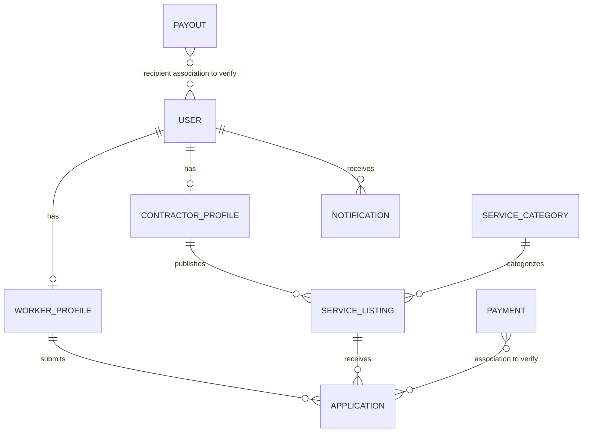

# WorkBridge — Database Design

## 1. Purpose

This document describes the database design for the WorkBridge application.

WorkBridge is a workforce marketplace that connects contractors with workers. The database stores user information, profiles, service listings, applications, notifications, payment information, and workforce allocation details.

The database design will be finalized by comparing it with the existing WorkBridge implementation before creating JPA entities.

## 2. Database Technology

| Component | Technology |
|---|---|
| Database | MySQL |
| ORM | Hibernate |
| Persistence | Spring Data JPA |
| Backend | Spring Boot |
| Database access | JPA repositories |

**Database name:** To be confirmed during backend configuration.

## 3. Main Database Entities

The following domain entities have been identified from the existing WorkBridge project context.

| Entity | Responsibility |
|---|---|
| User | Stores common account information and authentication details |
| WorkerProfile | Stores worker-specific profile information |
| ContractorProfile | Stores contractor-specific profile information |
| ServiceListing | Stores work opportunities published by contractors |
| ServiceCategory | Represents categories of available work |
| Application | Stores worker applications for service listings |
| Notification | Stores notifications sent to users |
| Payment | Stores payment-related information |
| Payout | Stores payout-related information |

The exact columns, constraints, and relationships must be verified against the old project source code.

## 4. Entity Responsibilities

### 4.1 User

The User entity represents an account registered on the WorkBridge platform.

Responsibilities:
- Store common account information.
- Support authentication.
- Identify the user's role.
- Connect an account to its corresponding profile.
- Support account-level authorization.

The platform also has a Super Admin role for administrative operations.

**Fields:** To be verified against the old implementation.

### 4.2 WorkerProfile

The WorkerProfile entity stores information specific to a worker.

Responsibilities:
- Maintain worker profile information.
- Connect worker information with the corresponding user account.
- Support worker participation in the marketplace.
- Provide profile information for contractor review.

**Fields and relationship cardinality:** To be verified against the old implementation.

### 4.3 ContractorProfile

The ContractorProfile entity stores information specific to a contractor.

Responsibilities:
- Maintain contractor profile information.
- Connect contractor information with the corresponding user account.
- Support publishing and managing service listings.
- Support contractor account administration.

Contractor account status includes the proposed administrative states:

- ACTIVE
- BLOCKED

The exact field name and implementation must be verified.

### 4.4 ServiceListing

The ServiceListing entity represents a work opportunity published by a contractor.

Responsibilities:
- Store work opportunity details.
- Identify the contractor who published the listing.
- Support service categorization.
- Support location and radius-based worker discovery.
- Track the listing lifecycle.

Known service statuses:

| Status | Meaning |
|---|---|
| OPEN | Listing is accepting applications |
| FILLED | Required workforce has been allocated |
| CANCELLED | Listing has been cancelled |
| COMPLETED | Work has been completed |

Exact fields and relationships must be verified.

### 4.5 ServiceCategory

Represents the category associated with a service listing.

Responsibilities:
- Organize service listings.
- Support category-based discovery.
- Provide a consistent classification of work opportunities.

Exact attributes and relationship cardinality must be verified.

### 4.6 Application

The Application entity represents a worker's application for a service listing.

Responsibilities:
- Connect a worker with a service listing.
- Maintain application information.
- Support contractor review and approval.
- Support workforce allocation.

Application statuses and permitted transitions must be extracted from the old implementation before defining the final database constraints.

### 4.7 Notification

The Notification entity stores notifications generated by WorkBridge.

Responsibilities:
- Associate notifications with relevant users.
- Store notification content.
- Support asynchronous notification delivery.

Notification fields and triggering events must be verified.

### 4.8 Payment

The Payment entity represents payment-related information associated with WorkBridge operations.

Responsibilities:
- Store payment-related records.
- Associate payments with the relevant business transaction.
- Support payment status tracking.

Exact payment ownership, relationships, and status values must be verified.

### 4.9 Payout

The Payout entity represents payout-related information.

Responsibilities:
- Store payout records.
- Associate payouts with the relevant recipient.
- Track payout processing.

Exact payout rules, fields, and relationships must be verified.

## 5. Initial Entity Relationship Diagram

The following diagram represents the conceptual domain structure. It is not yet the final physical database schema.

**Important:** The diagram is an initial conceptual representation. The payment/application association and payout/user association are placeholders, not confirmed relationships. Profile cardinalities and all other relationships must also be checked against the existing source code.

## 6. Data Integrity Requirements

The database should maintain the following integrity requirements:

1. Every persisted entity must have a valid primary key.
2. Foreign keys must reference existing records.
3. Required fields must not accept null values.
4. Unique constraints must be applied to fields that require uniqueness.
5. Application records must reference valid workers and service listings.
6. Service status values must follow the defined lifecycle.
7. Workforce allocation must not exceed the required capacity of a listing.
8. Payment and payout records must maintain valid associations with their related business records.

The exact constraints will be finalized after inspecting the existing implementation.

## 7. Transaction and Concurrency Considerations

WorkBridge contains a workforce allocation process in which multiple applications may be approved for the same service listing.

The database must prevent the required workforce capacity from being exceeded.

The existing implementation uses transactional processing and pessimistic locking for workforce allocation.

During the rebuild:
- Allocation operations must execute within a transaction.
- The relevant service listing must be protected against concurrent allocation updates.
- The available workforce capacity must be checked before approval.
- Allocation changes must be committed or rolled back consistently.

The exact locking query and transaction boundaries will be documented during implementation design.

## 8. Indexing Considerations

Indexes should be considered for frequently accessed fields.

Potential indexing candidates:

| Entity | Candidate fields | Reason |
|---|---|---|
| User | Login identifier | Account lookup and authentication |
| ServiceListing | Contractor reference | Retrieve contractor listings |
| ServiceListing | Category reference | Category-based discovery |
| ServiceListing | Status | Filter available listings |
| Application | Worker reference | Retrieve worker applications |
| Application | Service listing reference | Retrieve applications for a listing |
| Notification | User reference | Retrieve user notifications |

These are proposed candidates. Final indexes will depend on actual query patterns and existing constraints.

## 9. Items to Verify Against the Old Source Code

Before finalizing the database schema, inspect the previous WorkBridge implementation and verify:

- Exact fields and data types for every entity.
- Primary key generation strategy.
- Unique constraints and nullable fields.
- JPA relationship annotations and cardinalities.
- Application status values and transitions.
- Service listing capacity and allocation fields.
- Notification triggers and read/unread behavior.
- Payment and payout relationships and statuses.
- Contractor blocking behavior and its effect on existing records.
- Existing indexes and database constraints.

## 10. Database Design Completion Criteria

This document can be considered finalized when:

- All existing entities have been identified.
- All entity fields have been verified.
- Entity relationships match the old implementation.
- The ER diagram reflects the actual relationships.
- Status values and constraints have been verified.
- Transaction and concurrency requirements are documented.

**Next document:** `docs/03-Database/entity-relationships.md`

This next document will go deeper into JPA relationship mapping, ownership, foreign keys, and cascade behavior after we verify the existing mappings.