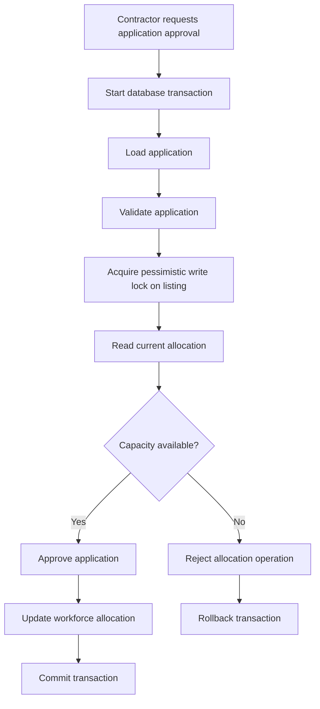

# WorkBridge — Transaction Management and Concurrency

## 1. Purpose

This document defines how WorkBridge handles database transactions and concurrent operations.

The primary focus is workforce allocation, where multiple applications may be approved for the same service listing.

The system must ensure that concurrent requests cannot allocate more workers than the contractor requires.

The existing WorkBridge implementation uses:
- Spring-managed transactions.
- Database transactions.
- Pessimistic locking.
- Hibernate/JPA.
- MySQL.

The rebuild must preserve this behavior.

## 2. Why Transaction Management Is Required

Consider a contractor who publishes a service listing requiring 5 workers.

Suppose 4 workers have already been allocated, leaving only 1 available position.

Now imagine two applications are approved at almost the same time.

Without concurrency control:

1. Request A reads the available capacity as 1.
2. Request B reads the available capacity as 1.
3. Request A approves an application.
4. Request B also approves an application.
5. Both requests may update the allocation.

The result could be 6 allocated workers when the requirement is only 5.

This is a race condition.

WorkBridge must prevent this situation.

## 3. Transaction Management

A transaction is a group of database operations that should succeed or fail as one logical unit.

WorkBridge uses transactions to maintain consistency during important business operations.

### 3.1 ACID Properties

| Property | Meaning | WorkBridge application |
|---|---|---|
| Atomicity | All operations succeed or fail together | Application approval and allocation |
| Consistency | Data remains valid before and after a transaction | Workforce capacity rules |
| Isolation | Concurrent transactions do not produce invalid results | Simultaneous approval requests |
| Durability | Committed changes persist | Saved application and allocation data |

### 3.2 Spring Transaction Management

Spring provides the `@Transactional` annotation for declarative transaction management.

Example:

```java
@Service
public class ApplicationService {

    @Transactional
    public void approveApplication(Long applicationId) {

        // Load application
        // Verify application status
        // Lock the related service listing
        // Check available workforce capacity
        // Approve the application
        // Update allocation information
    }
}
```

This is an illustrative structure. The actual method sequence and update operations must be verified against the old implementation.

### 3.3 Transaction Boundaries

The transaction should cover the complete logical allocation operation.

Expected sequence:

1. Receive an approval request.
2. Load the application.
3. Validate the application.
4. Acquire a lock on the relevant service listing.
5. Check current workforce allocation.
6. Verify available capacity.
7. Update the application and allocation information.
8. Commit the transaction.

If an operation fails, the transaction should roll back according to the application's exception and rollback configuration.

## 4. Pessimistic Locking

Pessimistic locking prevents multiple transactions from simultaneously modifying a protected database record.

WorkBridge uses pessimistic locking during workforce allocation.

The service listing is the logical resource that needs protection because its available workforce capacity is shared by multiple approval requests.

### 4.1 Why Pessimistic Locking?

Suppose two transactions attempt to approve different applications for the same listing.

- Transaction A acquires the lock.
- Transaction B must wait for the lock.
- Transaction A checks capacity and updates the allocation.
- Transaction A commits and releases the lock.
- Transaction B acquires the lock.
- Transaction B reads the updated allocation.
- Transaction B checks capacity again.

If no capacity remains, Transaction B must not approve the application.

This prevents over-allocation.

### 4.2 JPA Locking Annotation

JPA provides `@Lock` to define a locking mode on repository queries.

Illustrative example:

```java
public interface ServiceListingRepository
        extends JpaRepository<ServiceListing, Long> {

    @Lock(LockModeType.PESSIMISTIC_WRITE)
    @Query("SELECT s FROM ServiceListing s WHERE s.id = :id")
    Optional<ServiceListing> findByIdForUpdate(
            @Param("id") Long id
    );
}
```

The important annotation is:

```java
@Lock(LockModeType.PESSIMISTIC_WRITE)
```

It requests a write lock for the selected entity.

The exact repository method, query, and locking configuration must be verified against the previous implementation.

### 4.3 Lock Acquisition

A pessimistic write lock is intended to prevent conflicting transactions from modifying the locked record until the current transaction completes.

The database controls the lock lifecycle.

The lock is released when the transaction commits or rolls back.

## 5. Workforce Allocation Flow

The following diagram represents the intended concurrency-safe approval flow.



The exact handling of invalid applications, already-approved applications, and other failure cases must match the old business logic.

## 6. Concurrent Request Example

Assume:

- Required workers: 5
- Currently allocated workers: 4
- Available capacity: 1

Two approval requests arrive simultaneously.

| Step | Transaction A | Transaction B |
|---|---|---|
| 1 | Starts transaction | Starts transaction |
| 2 | Acquires listing lock | Waits for listing lock |
| 3 | Reads allocation = 4 | Waiting |
| 4 | Checks capacity = 1 | Waiting |
| 5 | Approves application | Waiting |
| 6 | Updates allocation to 5 | Waiting |
| 7 | Commits and releases lock | Acquires lock |
| 8 | Completed | Reads allocation = 5 |
| 9 | — | Finds no available capacity |
| 10 | — | Does not approve application |

Expected final result:

- Required workforce: 5
- Allocated workforce: 5
- Over-allocation: Not permitted.

## 7. Isolation and Database Behavior

Transaction isolation determines how concurrent database transactions interact.

Common isolation levels:

| Isolation level | Description |
|---|---|
| READ_UNCOMMITTED | Allows reading uncommitted changes |
| READ_COMMITTED | Reads only committed changes |
| REPEATABLE_READ | Maintains consistent reads within a transaction |
| SERIALIZABLE | Provides the strictest isolation behavior |

WorkBridge's actual isolation level must be checked from the database configuration and transaction settings.

Pessimistic locking is used to protect the critical service listing during allocation. The selected lock mode and transaction isolation level must work together correctly.

## 8. Failure Handling

The allocation operation must handle failures safely.

Potential failure scenarios:

| Scenario | Expected behavior |
|---|---|
| Application does not exist | Do not allocate workforce |
| Application is already processed | Prevent duplicate processing |
| Listing does not exist | Do not allocate workforce |
| Listing is not eligible for approval | Reject according to business rules |
| No workforce capacity remains | Do not approve the application |
| Database operation fails | Roll back the transaction |
| Concurrent request waits too long | Handle according to configured timeout and error policy |

The exact exception classes and API responses will be documented in the implementation and API documentation phases.

## 9. Important Implementation Considerations

### 9.1 Keep Transactions Focused

Transactions should cover the database operations required for the business operation.

Avoid keeping a database lock while performing unrelated slow operations.

### 9.2 Avoid External Calls While Holding Locks

External operations such as sending emails or invoking third-party services should generally not execute while a database lock is held.

If notifications are triggered by an approval, their delivery mechanism should be designed so that database consistency is not dependent on a slow external service.

The existing asynchronous notification behavior must be preserved.

### 9.3 Validate Before Updating

The application and listing must be validated before changing their state.

Validation must also happen inside the protected transaction where it depends on shared allocation data.

### 9.4 Prevent Duplicate Approval

The system must prevent an application from being approved more than once through simultaneous requests.

The exact status validation and database safeguards must be verified against the existing implementation.

## 10. Verification Against the Old Implementation

Before rebuilding the allocation mechanism, inspect the previous source code and confirm:

- [ ] Which service method contains `@Transactional`.
- [ ] Which repository query uses pessimistic locking.
- [ ] Whether `PESSIMISTIC_WRITE` is used.
- [ ] Which entity is locked.
- [ ] How required workforce capacity is stored.
- [ ] How current allocation is calculated or stored.
- [ ] How an application is approved.
- [ ] How duplicate approval is prevented.
- [ ] How rollback is handled.
- [ ] Whether notifications are triggered asynchronously.
- [ ] Whether lock timeouts or transaction isolation are configured.

## 11. Completion Criteria

The transaction and concurrency design is complete when:

1. Transaction boundaries are identified.
2. The pessimistic locking implementation is verified.
3. Workforce capacity validation is documented.
4. Concurrent approvals cannot cause over-allocation.
5. Duplicate approval is prevented.
6. Failure and rollback behavior is understood.
7. Existing asynchronous notification behavior is preserved.

**Next document:** `docs/03-Database/database-design-verification.md`

This document will serve as the final database review checklist before moving to API documentation.