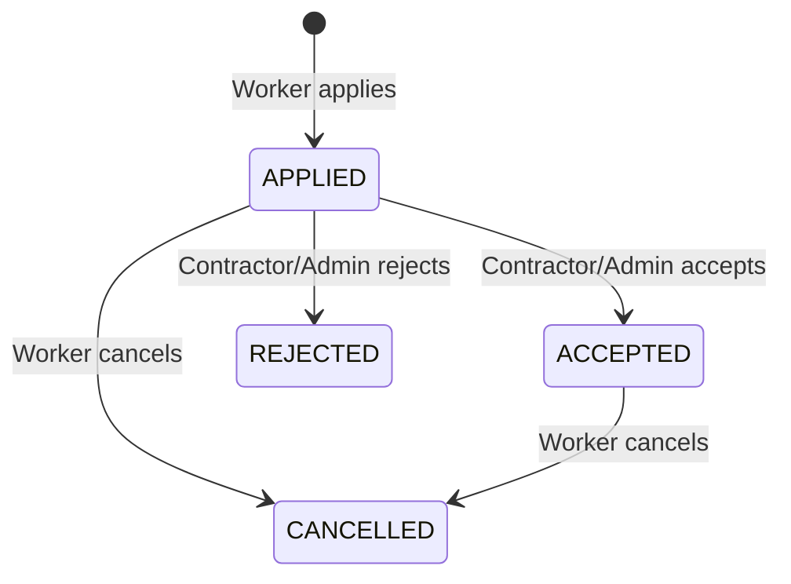

# Application Management API

## 1. Purpose

The Application Management API handles the complete worker application lifecycle in WorkBridge.

It allows:

- Workers to apply for available service listings.
- Workers to view their own applications.
- Contractors to view applications submitted for their service listings.
- Contractors to accept or reject applications.
- Workers to cancel their own applications.
- The system to maintain the accepted-worker count when applications are accepted or cancelled.

This document describes the API implemented in the original WorkBridge backend and serves as the reference for rebuilding this module.

## 2. Base Path

All application endpoints are exposed under:

```text
/api
```

## 3. API Endpoint Summary

| HTTP Method | Endpoint | Access |
|---|---|---|
| POST | `/api/services/{serviceId}/applications` | WORKER |
| GET | `/api/applications/my-applications` | WORKER |
| GET | `/api/services/{serviceId}/applications` | ADMIN or owning CONTRACTOR |
| PUT | `/api/applications/{id}/accept` | ADMIN or owning CONTRACTOR |
| PUT | `/api/applications/{id}/reject` | ADMIN or owning CONTRACTOR |
| PUT | `/api/applications/{id}/cancel` | Owning WORKER |

There is no application deletion endpoint in the original implementation.

## 4. Authentication and Authorization

All application operations use the authenticated user's identity.

The backend obtains the user's email from the Spring Security `Authentication` object.

| Role | Permissions |
|---|---|
| WORKER | Apply for services, view own applications, cancel own applications |
| CONTRACTOR | View applications for owned services, accept applications, reject applications |
| ADMIN | View applications for any service, accept applications, reject applications |

### Ownership verification

The application security evaluator performs ownership checks.

- `isApplicationOwner()` verifies that the authenticated worker owns the application.
- `isServiceOwnerOfApplication()` verifies that the application belongs to a service owned by the authenticated contractor.

A contractor cannot manage applications belonging to another contractor's service.

## 5. API Details

### 5.1 Apply for a Service

**Endpoint**

```http
POST /api/services/{serviceId}/applications
```

**Access:** WORKER only.

**Path parameter**

| Parameter | Type | Description |
|---|---|---|
| serviceId | Long | ID of the service listing |

**Request body:** None.

The authenticated worker's identity is obtained from the security context.

**Success response:** `201 Created`

```json
{
  "id": 101,
  "serviceId": 25,
  "serviceTitle": "Event Management Staff",
  "workerId": 12,
  "workerName": "Ravi Kumar",
  "status": "APPLIED",
  "appliedAt": "2026-11-05T10:30:00",
  "updatedAt": "2026-11-05T10:30:00"
}
```

**Business validations**

1. The worker profile must exist.
2. The service listing must exist.
3. The service status must be `OPEN`.
4. The service date must not be in the past.
5. The worker must not have an existing application for the same service.
6. The accepted-worker count must be below the required-worker count.

**Important:** The original implementation prevents duplicate applications using the worker ID and service ID combination. The database also has a unique constraint on `service_id` and `worker_id`.

### 5.2 Get My Applications

**Endpoint**

```http
GET /api/applications/my-applications
```

**Access:** WORKER only.

**Request body:** None.

The backend identifies the worker through the authenticated user's email.

**Success response:** `200 OK`

```json
[
  {
    "id": 101,
    "serviceId": 25,
    "serviceTitle": "Event Management Staff",
    "workerId": 12,
    "workerName": "Ravi Kumar",
    "status": "APPLIED",
    "appliedAt": "2026-11-05T10:30:00",
    "updatedAt": "2026-11-05T10:30:00"
  },
  {
    "id": 102,
    "serviceId": 30,
    "serviceTitle": "Warehouse Assistant",
    "workerId": 12,
    "workerName": "Ravi Kumar",
    "status": "ACCEPTED",
    "appliedAt": "2026-11-05T11:00:00",
    "updatedAt": "2026-11-05T11:15:00"
  }
]
```

The endpoint returns applications belonging to the authenticated worker.

### 5.3 Get Applications for a Service

**Endpoint**

```http
GET /api/services/{serviceId}/applications
```

**Access:**
- ADMIN
- CONTRACTOR who owns the requested service

**Path parameter**

| Parameter | Type | Description |
|---|---|---|
| serviceId | Long | ID of the service listing |

**Request body:** None.

**Success response:** `200 OK`

```json
[
  {
    "id": 101,
    "serviceId": 25,
    "serviceTitle": "Event Management Staff",
    "workerId": 12,
    "workerName": "Ravi Kumar",
    "status": "APPLIED",
    "appliedAt": "2026-11-05T10:30:00",
    "updatedAt": "2026-11-05T10:30:00"
  }
]
```

This endpoint allows a contractor to review the workers who applied for a particular service.

### 5.4 Accept an Application

**Endpoint**

```http
PUT /api/applications/{id}/accept
```

**Access:**
- ADMIN
- CONTRACTOR who owns the service associated with the application

**Path parameter**

| Parameter | Type | Description |
|---|---|---|
| id | Long | Application ID |

**Request body:** None.

**Success response:** `200 OK`

```json
{
  "id": 101,
  "serviceId": 25,
  "serviceTitle": "Event Management Staff",
  "workerId": 12,
  "workerName": "Ravi Kumar",
  "status": "ACCEPTED",
  "appliedAt": "2026-11-05T10:30:00",
  "updatedAt": "2026-11-05T10:45:00"
}
```

**Business logic**

1. Find the application.
2. Lock the associated service listing using a pessimistic write lock.
3. If the application is already `ACCEPTED`, return its existing response.
4. Reject the operation if the application is `CANCELLED` or `REJECTED`.
5. Check whether the service has reached its required-worker capacity.
6. Change the application status to `ACCEPTED`.
7. Increment the service's `acceptedWorkers` count.
8. If accepted workers equal required workers, change the service status to `FILLED`.
9. Save the application and service.
10. Publish the relevant notification events.

**Capacity management**

For example:

```text
Required Workers = 5
Accepted Workers = 4
```

After accepting one application:

```text
Required Workers = 5
Accepted Workers = 5
Service Status = FILLED
```

The system must not allow accepted workers to exceed the required-worker count.

### 5.5 Reject an Application

**Endpoint**

```http
PUT /api/applications/{id}/reject
```

**Access:**
- ADMIN
- CONTRACTOR who owns the service associated with the application

**Path parameter**

| Parameter | Type | Description |
|---|---|---|
| id | Long | Application ID |

**Request body:** None.

**Success response:** `200 OK`

```json
{
  "id": 101,
  "serviceId": 25,
  "serviceTitle": "Event Management Staff",
  "workerId": 12,
  "workerName": "Ravi Kumar",
  "status": "REJECTED",
  "appliedAt": "2026-11-05T10:30:00",
  "updatedAt": "2026-11-05T11:00:00"
}
```

**Business logic**

1. Find the application.
2. If its status is already `REJECTED`, return the existing response.
3. If its status is `ACCEPTED`, reject the operation.
4. Otherwise, change its status to `REJECTED`.
5. Save the updated application.
6. Publish a notification event for the worker.

The original implementation does not decrement the accepted-worker count when rejecting an application because an accepted application cannot be rejected through this operation.

### 5.6 Cancel an Application

**Endpoint**

```http
PUT /api/applications/{id}/cancel
```

**Access:** The WORKER who owns the application.

**Path parameter**

| Parameter | Type | Description |
|---|---|---|
| id | Long | Application ID |

**Request body:** None.

**Success response:** `200 OK`

```json
{
  "id": 101,
  "serviceId": 25,
  "serviceTitle": "Event Management Staff",
  "workerId": 12,
  "workerName": "Ravi Kumar",
  "status": "CANCELLED",
  "appliedAt": "2026-11-05T10:30:00",
  "updatedAt": "2026-11-05T11:30:00"
}
```

**Business logic**

1. Find the application.
2. If the application is already `CANCELLED`, return its existing response.
3. If the application is `ACCEPTED`, lock the associated service listing.
4. Decrement the service's accepted-worker count.
5. If the service status is `FILLED`, change it back to `OPEN`.
6. Save the service.
7. Change the application status to `CANCELLED`.
8. Save the application.

The accepted-worker count is reduced only when the cancelled application was previously accepted.

The original implementation does not publish a notification event when an application is cancelled.

## 6. Application Status Lifecycle

The original application status enum contains four values:

| Status | Meaning |
|---|---|
| APPLIED | Worker has submitted an application |
| ACCEPTED | Contractor or admin has accepted the application |
| REJECTED | Contractor or admin has rejected the application |
| CANCELLED | Worker has cancelled the application |

### Status transition rules



Additional implementation behavior:

- Accepting an already accepted application returns the existing application.
- Rejecting an already rejected application returns the existing application.
- Cancelling an already cancelled application returns the existing application.
- Rejecting an accepted application is not allowed.
- Accepting a rejected or cancelled application is not allowed.
- The original cancellation implementation does not explicitly prohibit cancellation of a rejected application.

## 7. Application Response DTO

The original backend uses `ApplicationResponse`.

| Field | Java Type | Description |
|---|---|---|
| id | Long | Application ID |
| serviceId | Long | Associated service ID |
| serviceTitle | String | Service title |
| workerId | Long | Worker profile ID |
| workerName | String | Worker's full name |
| status | String | Current application status |
| appliedAt | LocalDateTime | Application creation timestamp |
| updatedAt | LocalDateTime | Last update timestamp |

All application endpoints return this response structure, either as a single object or a list.

## 8. Database Entity

The original application entity maps to the `applications` table.

| Column | Description |
|---|---|
| id | Primary key |
| service_id | Associated service listing |
| worker_id | Associated worker profile |
| status | Application status |
| applied_at | Creation timestamp |
| updated_at | Last modification timestamp |

**Relationships**

- Many applications can belong to one service listing.
- Many applications can belong to one worker profile.
- A worker can apply only once to a particular service listing.

**Database constraint**

```text
UNIQUE(service_id, worker_id)
```

The entity uses JPA auditing annotations for `appliedAt` and `updatedAt`.

## 9. Transaction Management and Concurrency

Application operations must preserve the service's workforce capacity.

The original implementation uses:

- `@Transactional` for application creation and status-changing operations.
- Pessimistic write locking when applying for a service.
- Pessimistic write locking when accepting an application.
- Pessimistic write locking when cancelling an accepted application.

### Why pessimistic locking is important

Consider a service with:

```text
Required Workers = 5
Accepted Workers = 4
```

Two contractors/admin requests attempt to accept different applications at nearly the same time.

Without proper locking, both operations could read the accepted count as 4 and both increment it, resulting in 6 accepted workers.

With a pessimistic write lock, the operations are serialized around the service listing. The second operation checks the updated capacity and cannot overfill the service.

The rebuild must preserve this concurrency protection.

## 10. Notification Events

The application service publishes in-app notification events for these operations:

| Event | Recipient | Notification title |
|---|---|---|
| New application submitted | Service owner / Contractor | New Application Received |
| Application accepted | Worker | Application Accepted |
| Service becomes fully staffed | Service owner / Contractor | Service Filled |
| Application rejected | Worker | Application Screened |

The original application service does not publish a notification event for worker cancellation.

Notifications are published through Spring's `ApplicationEventPublisher` using `InAppNotificationEvent`.

## 11. Repository Operations

The original `ApplicationRepository` extends `JpaRepository<Application, Long>`.

The relevant derived query methods are:

| Method | Purpose |
|---|---|
| `findByWorkerId()` | Retrieve applications for a worker |
| `findByServiceId()` | Retrieve applications for a service |
| `findByServiceContractorId()` | Retrieve applications associated with a contractor |
| `findByWorkerIdAndServiceId()` | Find an application for a worker-service pair |
| `existsByWorkerIdAndServiceId()` | Check whether a worker has already applied |

## 12. Error and Validation Scenarios

The application service uses domain exceptions for invalid operations.

| Scenario | Expected business outcome |
|---|---|
| Worker profile does not exist | Resource not found |
| Service listing does not exist | Resource not found |
| Application does not exist | Resource not found |
| Service is not OPEN | Application rejected |
| Service date is in the past | Application rejected |
| Worker applies twice to the same service | Duplicate application rejected |
| Service capacity is already full | Application rejected |
| Application is REJECTED or CANCELLED and someone tries to accept it | Invalid state transition |
| Accepted application is rejected | Invalid state transition |
| Contractor attempts to manage another contractor's application | Authorization denied |
| Worker attempts to cancel another worker's application | Authorization denied |

Exact HTTP error response formats and status mappings are governed by the common exception-handling implementation.

## 13. Implementation Gaps to Review During Rebuild

The following are observations from the original source, not additional requirements:

1. There is no endpoint to retrieve one application by its ID.
2. Application listing endpoints do not implement pagination.
3. There is no application deletion endpoint.
4. The original service does not explicitly prevent cancellation of a rejected application.
5. The original rejection logic does not explicitly prevent changing a cancelled application to rejected.
6. Cancellation does not publish a notification event.
7. The original application service does not explicitly check whether a contractor is blocked before accepting or rejecting an application. This should be reviewed alongside the contractor-blocking authorization rules.

These points must be discussed before changing the original behavior.

## 14. Rebuild Requirements

The rebuilt application module must preserve the following existing behavior:

- Workers can apply for OPEN service listings.
- A worker cannot apply more than once to the same service.
- Workers can view only their own applications.
- Contractors can view and manage applications only for their own services.
- Admins can manage applications across services.
- Contractors/admins can accept or reject applications.
- Workers can cancel their own applications.
- Accepting an application updates the accepted-worker count.
- Reaching the required-worker count changes the service status to `FILLED`.
- Cancelling an accepted application decreases the accepted-worker count.
- Cancelling an accepted application reopens a FILLED service.
- Pessimistic locking protects workforce capacity during concurrent operations.
- Existing notification events are preserved.

