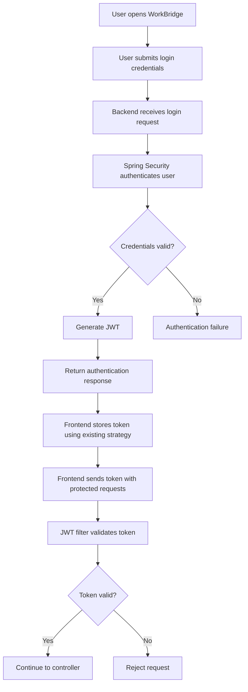

# WorkBridge — Authentication and Authorization API

## 1. Purpose

This document describes the authentication and authorization functionality of the WorkBridge application.

Authentication verifies the identity of a user, while authorization determines which operations the authenticated user is permitted to perform.

WorkBridge uses:

- Spring Security for application security.
- JWT for token-based authentication.
- BCrypt for password hashing.
- Role-based authorization for access control.

The exact API contracts must be verified against the existing WorkBridge backend.

## 2. Authentication Architecture

WorkBridge uses token-based authentication.

The expected high-level authentication flow is:



The exact filter sequence and frontend token storage mechanism must be confirmed from the old implementation.

## 3. User Roles

WorkBridge has three application roles.

| Role | Responsibility |
|---|---|
| WORKER | Access worker functionality |
| CONTRACTOR | Manage contractor functionality |
| SUPER_ADMIN | Manage platform-level administrative operations |

The exact enum values and role representation must be verified.

## 4. Authentication API

### 4.1 Login API

**Purpose:** Authenticate a registered user using the existing login credentials.

| Property | Details |
|---|---|
| Endpoint | To be verified |
| HTTP method | To be verified |
| Authentication required | No, unless existing implementation specifies otherwise |
| Request content type | To be verified |
| Request DTO | To be verified |
| Response DTO | To be verified |

**Expected functionality:**

1. Receive login credentials.
2. Locate the corresponding user account.
3. Verify the submitted password using the configured password encoder.
4. Authenticate the user.
5. Generate a JWT if authentication succeeds.
6. Return the existing authentication response.

**Request fields:** To be extracted from the old login request DTO.

**Response fields:** To be extracted from the old authentication response DTO.

### 4.2 Registration APIs

WorkBridge supports worker and contractor accounts.

The registration endpoint structure must be verified from the existing controllers.

| Registration type | Endpoint | HTTP method | Status |
|---|---|---|---|
| Worker registration | To be verified | To be verified | Pending |
| Contractor registration | To be verified | To be verified | Pending |

Verify:

- Required registration fields.
- User creation behavior.
- Profile creation behavior.
- Password hashing.
- Duplicate account validation.
- Default role assignment.
- Registration response structure.

Do not assume that worker and contractor registration use separate endpoints.

### 4.3 Logout API

Logout behavior must be verified against the existing authentication implementation.

Investigate:

- Whether a logout endpoint exists.
- Whether JWT tokens are invalidated server-side.
- Whether the frontend simply removes its stored token.
- Whether refresh tokens are supported.
- Whether token revocation or blacklisting is implemented.

Do not introduce token blacklisting or refresh-token functionality unless it exists in the original application.

## 5. JWT Authentication

### 5.1 JWT Purpose

A JSON Web Token is used to authenticate requests after successful login.

The frontend sends the token with requests to protected backend endpoints, according to the existing token transport strategy.

### 5.2 Authorization Header

If the existing implementation uses bearer-token authentication, the request header follows this format:

```http
Authorization: Bearer <JWT_TOKEN>
```

The actual header handling must be verified against the JWT filter.

### 5.3 JWT Verification

The backend must verify the token before allowing a protected request to proceed.

Verify the following from the old implementation:

- Token generation logic.
- Token signature verification.
- Secret key or signing key configuration.
- Token expiration.
- User identity extraction.
- Role or authority extraction.
- Invalid token handling.
- Expired token handling.

### 5.4 JWT Configuration

| Configuration | Value |
|---|---|
| Token signing strategy | To be verified |
| Token expiration | To be verified |
| Secret/key configuration | To be verified |
| Claims | To be verified |
| Token transport | To be verified |
| Refresh-token support | To be verified |

Secrets must be stored securely and must not be committed to the GitHub repository.

## 6. Password Security

WorkBridge uses BCrypt for password hashing.

Expected security behavior:

1. Receive the password during registration.
2. Hash the password using BCrypt.
3. Persist the encoded password.
4. Retrieve the stored encoded password during login.
5. Verify the submitted password using the password encoder.
6. Never return the encoded password through API responses.

Illustrative Spring configuration:

```java
@Bean
public PasswordEncoder passwordEncoder() {
    return new BCryptPasswordEncoder();
}
```

The actual BCrypt configuration and strength must be verified against the old implementation.

## 7. Role-Based Authorization

Role-based authorization restricts access to operations according to the authenticated user's role.

### 7.1 Worker Permissions

The worker role is associated with worker-specific operations.

Verify the existing permissions for:

- Worker profile management.
- Service listing discovery.
- Application submission.
- Application history.
- Notifications.
- Payment-related operations, if applicable.

### 7.2 Contractor Permissions

The contractor role is associated with contractor-specific operations.

Verify the existing permissions for:

- Contractor profile management.
- Service listing creation.
- Service listing updates.
- Service listing management.
- Application review.
- Worker approval.
- Workforce allocation.
- Payment and payout operations.

### 7.3 Super Admin Permissions

The Super Admin role is responsible for platform-level administration.

Known administrative functionality:

- Manage contractor access.
- Block contractor accounts.
- Unblock contractor accounts.

Other permissions must be verified against the existing implementation.

## 8. Contractor Blocking and Authorization

Contractor blocking is an administrative operation.

The intended account states are:

| State | Meaning |
|---|---|
| ACTIVE | Contractor account is active |
| BLOCKED | Contractor account has been blocked |

The existing implementation must be inspected to determine:

- How contractor status is stored.
- Which operations are denied after blocking.
- Whether an existing JWT remains valid after blocking.
- Whether every protected request checks current account status.
- Whether pending applications are affected.
- Whether existing listings remain visible.
- Whether already-approved workers are affected.
- Whether payments and payouts remain accessible.
- How unblocking restores access.

A valid JWT alone should not be treated as proof that a blocked contractor is authorized to perform an operation.

The rebuild must preserve the original blocking behavior.

## 9. Authentication and Authorization Errors

The API documentation must record the actual response behavior for these cases:

| Scenario | Expected HTTP category |
|---|---|
| Missing authentication | 401 Unauthorized |
| Invalid token | 401 Unauthorized |
| Expired token | 401 Unauthorized |
| Authenticated user lacks permission | 403 Forbidden |
| Invalid login credentials | To be verified |
| Blocked contractor | To be verified |
| Invalid registration data | 400 Bad Request |

The final response bodies and status codes must be extracted from the existing exception handling and security configuration.

## 10. Security Configuration Verification

Inspect the existing Spring Security configuration and record:

- Security configuration class.
- Security filter chain configuration.
- JWT authentication filter.
- Authentication provider.
- Authentication manager.
- Password encoder.
- UserDetailsService implementation.
- Public endpoints.
- Protected endpoints.
- Role and authority mapping.
- Method-level authorization annotations.
- Session management policy.
- CORS configuration.
- CSRF configuration.

No security configuration should be changed merely to match this document.

## 11. API Endpoint Verification Table

Complete this table after inspecting the old backend.

| Operation | Controller | Endpoint | Method | Authorization |
|---|---|---|---|---|
| Login | Pending | Pending | Pending | Public, to verify |
| Worker registration | Pending | Pending | Pending | Public, to verify |
| Contractor registration | Pending | Pending | Pending | Public, to verify |
| Logout | Pending | Pending | Pending | To verify |
| Block contractor | Pending | Pending | Pending | SUPER_ADMIN, to verify |
| Unblock contractor | Pending | Pending | Pending | SUPER_ADMIN, to verify |

## 12. Verification Checklist

### Authentication

- [ ] Login endpoint verified.
- [ ] Worker registration endpoint verified.
- [ ] Contractor registration endpoint verified.
- [ ] Logout behavior verified.
- [ ] Request DTOs verified.
- [ ] Response DTOs verified.
- [ ] Password hashing verified.

### JWT

- [ ] Token generation verified.
- [ ] Token validation verified.
- [ ] Signing configuration verified.
- [ ] Expiration verified.
- [ ] Claims verified.
- [ ] Authentication filter verified.
- [ ] Token transport verified.

### Authorization

- [ ] WORKER permissions verified.
- [ ] CONTRACTOR permissions verified.
- [ ] SUPER_ADMIN permissions verified.
- [ ] Public endpoints verified.
- [ ] Protected endpoints verified.
- [ ] Blocked contractor behavior verified.

### Error Handling

- [ ] Invalid credentials response verified.
- [ ] Missing token response verified.
- [ ] Invalid token response verified.
- [ ] Expired token response verified.
- [ ] Forbidden response verified.

## 13. Completion Criteria

This document is complete when:

1. All authentication endpoints are identified.
2. Registration and login contracts are verified.
3. JWT implementation details are documented.
4. Password security behavior is verified.
5. Role-based authorization is documented.
6. Contractor blocking behavior is confirmed.
7. Security-related error responses are verified.

**Next document:** `docs/04-API/user-and-profile-api.md`