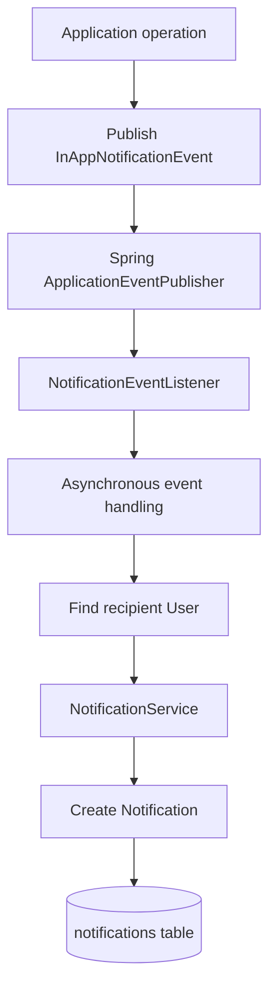

# Notification Management API

## 1. Purpose

The Notification Management API handles in-app notifications in WorkBridge.

Notifications inform users about important activities, including:

- A worker submitting an application.
- A contractor accepting an application.
- A contractor rejecting an application.
- A service becoming fully staffed.

The notification module supports retrieving all notifications, retrieving unread notifications, and marking individual notifications as read.

## 2. Base Path

```text
/api/notifications
```

## 3. API Endpoint Summary

| HTTP Method | Endpoint | Access |
|---|---|---|
| GET | `/api/notifications` | Any authenticated user |
| GET | `/api/notifications/unread` | Any authenticated user |
| PUT | `/api/notifications/{id}/read` | Any authenticated user, notification owner only |

## 4. Authentication and Authorization

All notification endpoints require authentication.

The authenticated user's email is obtained from Spring Security's `Authentication` object.

**Important authorization rule:** Users can retrieve only their own notifications. A user cannot mark another user's notification as read.

The ownership check is performed inside `NotificationService.markAsRead()`.

## 5. API Details

### 5.1 Get All Notifications

**Endpoint**

```http
GET /api/notifications
```

**Access:** Any authenticated user.

**Request body:** None.

**Success response:** `200 OK`

```json
[
  {
    "id": 1,
    "title": "New Application Received",
    "message": "A worker has applied for your service.",
    "read": false,
    "createdAt": "2026-11-05T10:30:00"
  },
  {
    "id": 2,
    "title": "Application Accepted",
    "message": "Your application has been accepted.",
    "read": true,
    "createdAt": "2026-11-05T09:30:00"
  }
]
```

**Business logic**

1. Obtain the authenticated user's email.
2. Find the corresponding user.
3. Retrieve notifications belonging to that user.
4. Sort notifications by creation time in descending order.
5. Return the notification list.

### 5.2 Get Unread Notifications

**Endpoint**

```http
GET /api/notifications/unread
```

**Access:** Any authenticated user.

**Request body:** None.

**Success response:** `200 OK`

```json
[
  {
    "id": 1,
    "title": "New Application Received",
    "message": "A worker has applied for your service.",
    "read": false,
    "createdAt": "2026-11-05T10:30:00"
  }
]
```

**Business logic**

1. Obtain the authenticated user's email.
2. Find the corresponding user.
3. Retrieve notifications where the user's ID matches and `read = false`.
4. Sort by creation time in descending order.
5. Return the unread notification list.

### 5.3 Mark a Notification as Read

**Endpoint**

```http
PUT /api/notifications/{id}/read
```

**Access:** Any authenticated user, but only the notification owner can perform the operation.

**Path parameter**

| Parameter | Type | Description |
|---|---|---|
| id | Long | Notification ID |

**Request body:** None.

**Success response:** `200 OK`

The endpoint returns an empty response body.

**Business logic**

1. Find the notification using its ID.
2. If the notification does not exist, throw a `ResourceNotFoundException`.
3. Compare the notification owner's email with the authenticated user's email.
4. If the notification belongs to another user, throw a `ForbiddenException`.
5. Set `read = true`.
6. Save the updated notification.

Calling this endpoint for an already-read notification leaves it in the read state.

## 6. Notification Entity

The original backend maps notifications to the `notifications` table.

| Field | Java Type | Description |
|---|---|---|
| id | Long | Primary key |
| user | User | Notification recipient |
| title | String | Notification title |
| message | String | Notification message |
| read | boolean | Whether the notification has been read |
| createdAt | LocalDateTime | Notification creation timestamp |

### Database mapping

| Column | Constraint / Mapping |
|---|---|
| id | Primary key, auto-generated |
| user_id | Foreign key, not null |
| title | Not null, maximum length 200 |
| message | Not null, TEXT column |
| is_read | Not null |
| created_at | Not null, not updatable |

The entity uses `@CreatedDate` and `AuditingEntityListener` for creation timestamp auditing.

The `user` relationship uses `@ManyToOne(fetch = FetchType.LAZY)`. The user field is annotated with `@JsonIgnore`.

## 7. Repository Operations

The original `NotificationRepository` extends:

```java
JpaRepository<Notification, Long>
```

It defines the following derived query methods:

| Method | Purpose |
|---|---|
| `findByUserIdOrderByCreatedAtDesc(Long userId)` | Retrieves all notifications for a user, newest first |
| `findByUserIdAndReadFalseOrderByCreatedAtDesc(Long userId)` | Retrieves unread notifications for a user, newest first |

No pagination is implemented in the original repository methods.

## 8. Notification Event Architecture

WorkBridge uses Spring's application event mechanism to create notifications asynchronously.

The main components are:

- `NotificationEvent`
- `InAppNotificationEvent`
- `NotificationEventListener`
- `NotificationService`

### Event flow



### NotificationEvent

`NotificationEvent` is an abstract class extending Spring's `ApplicationEvent`.

It contains:

| Field | Type | Description |
|---|---|---|
| recipientId | Long | User receiving the notification |
| title | String | Notification title |
| message | String | Notification content |

### InAppNotificationEvent

`InAppNotificationEvent` extends `NotificationEvent` and represents an in-app notification event.

It is published by other modules using Spring's `ApplicationEventPublisher`.

### NotificationEventListener

The listener uses:

```java
@Async
@EventListener
```

When an event is published:

1. The listener receives the event.
2. It finds the recipient using `recipientId`.
3. It calls `NotificationService.createNotification()`.
4. The notification is saved with `read = false`.

The listener catches exceptions and logs failures.

**Important:** Notification creation is asynchronous. The original implementation does not expose a notification-creation REST endpoint.

## 9. Notification Triggers

The original application module publishes the following notification events:

| Trigger | Recipient | Title |
|---|---|---|
| Worker submits an application | Service owner / Contractor | New Application Received |
| Application is accepted | Worker | Application Accepted |
| Service becomes fully staffed | Service owner / Contractor | Service Filled |
| Application is rejected | Worker | Application Screened |

The application cancellation operation does not publish a notification event in the original implementation.

## 10. Transaction Management

The original notification service uses transaction management:

| Method | Transaction |
|---|---|
| `createNotification()` | `@Transactional` |
| `getMyNotifications()` | `@Transactional(readOnly = true)` |
| `getMyUnreadNotifications()` | `@Transactional(readOnly = true)` |
| `markAsRead()` | `@Transactional` |

The event listener handles notification creation asynchronously.

The rebuild must preserve the separation between event publishing and notification persistence.

## 11. Error Scenarios

| Scenario | Expected outcome |
|---|---|
| Authenticated user does not exist | Resource not found |
| Notification ID does not exist | Resource not found |
| User tries to mark another user's notification as read | Forbidden |
| Notification event recipient does not exist | Listener logs the failure |

Exact HTTP error response formats are governed by the common exception-handling implementation.

## 12. Implementation Gaps to Review During Rebuild

The following features are not present in the original notification controller:

1. No endpoint to delete a notification.
2. No endpoint to mark all notifications as read.
3. No endpoint to retrieve notification details by ID.
4. No pagination for notification retrieval.
5. No unread notification count endpoint.
6. No WebSocket or Server-Sent Events endpoint for real-time notification delivery.

These are observations, not new requirements. Do not add them without discussing the change.

## 13. Rebuild Requirements

The rebuilt notification module must preserve:

- Every authenticated user can retrieve their own notifications.
- Users can retrieve only unread notifications.
- Users can mark only their own notifications as read.
- Notifications are created through application events.
- Event handling is asynchronous.
- Notification records are persisted in MySQL.
- Notifications are initially created with `read = false`.
- Notifications are ordered newest first when retrieved.
- Existing application notification triggers are preserved.


