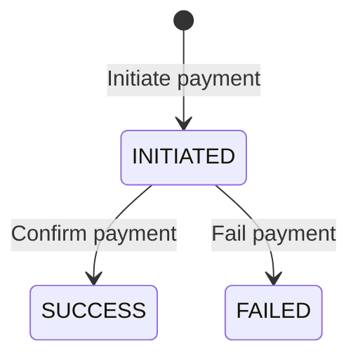
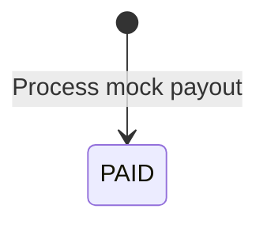

# Payment and Payout API

## 1. Purpose

The Payment and Payout module manages the financial transaction simulation in WorkBridge.

It supports two main operations:

**Payment**
- Contractors initiate payments for their service listings.
- Contractors confirm a payment.
- Contractors mark a payment as failed.

**Payout**
- Contractors or admins process payouts for accepted worker applications.
- The system records payout details against the worker and application.

The original implementation uses mock gateway identifiers. It does not integrate with an actual payment gateway.

## 2. Base Path

```text
/api/payments
```

## 3. API Endpoint Summary

| HTTP Method | Endpoint | Access |
|---|---|---|
| POST | `/api/payments/initiate` | Owning CONTRACTOR |
| POST | `/api/payments/confirm` | CONTRACTOR |
| POST | `/api/payments/fail` | CONTRACTOR |
| POST | `/api/payments/payout` | ADMIN or owning CONTRACTOR |

There are no separate payout controller endpoints. Payout processing is exposed through the payment controller.

## 4. Authentication and Authorization

All endpoints require authentication and use method-level authorization through Spring Security.

| Operation | Authorization |
|---|---|
| Initiate payment | Contractor who owns the service |
| Confirm payment | Any authenticated CONTRACTOR |
| Fail payment | Any authenticated CONTRACTOR |
| Process payout | ADMIN or contractor who owns the application’s service |

### Ownership checks

The payment initiation endpoint uses:

```java
@serviceSecurity.isServiceOwner(#serviceId, authentication.name)
```

The payout endpoint uses:

```java
@applicationSecurity.isServiceOwnerOfApplication(
    #applicationId,
    authentication.name
)
```

**Important implementation observation:** The confirm and fail endpoints check only the CONTRACTOR role. They do not perform an ownership check against the payment's contractor or service.

## 5. Payment API Details

### 5.1 Initiate Payment

**Endpoint**

```http
POST /api/payments/initiate
```

**Access:** CONTRACTOR who owns the service.

**Request parameters**

| Parameter | Type | Required | Description |
|---|---|---|---|
| serviceId | Long | Yes | Service listing ID |
| amount | BigDecimal | Yes | Payment amount |

These values are sent as request parameters, not as a JSON request body.

**Example request**

```http
POST /api/payments/initiate?serviceId=25&amount=5000.00
```

**Success response:** `200 OK`

The controller returns the `Payment` entity.

Example response structure:

```json
{
  "id": 1,
  "amount": 5000.00,
  "gatewayOrderId": "pay_a1b2c3d4e5f6g7h8",
  "status": "INITIATED",
  "createdAt": "2026-11-05T10:30:00",
  "updatedAt": "2026-11-05T10:30:00"
}
```

**Business logic**

1. Find the service listing using `serviceId`.
2. Find the contractor profile using the authenticated contractor's email.
3. Generate a mock gateway order ID.
4. Create a payment associated with the service and contractor.
5. Set the initial payment status to `INITIATED`.
6. Save the payment.
7. Return the saved payment.

The mock gateway order ID is generated using a UUID-based value with the `pay_` prefix.

**Important:** The original service does not explicitly validate that the amount is positive or enforce a payment amount against the service's business requirements.

### 5.2 Confirm Payment

**Endpoint**

```http
POST /api/payments/confirm
```

**Access:** CONTRACTOR.

**Request parameter**

| Parameter | Type | Required | Description |
|---|---|---|---|
| gatewayOrderId | String | Yes | Gateway order ID generated during payment initiation |

**Example request**

```http
POST /api/payments/confirm?gatewayOrderId=pay_a1b2c3d4e5f6g7h8
```

**Success response:** `200 OK`

```json
{
  "id": 1,
  "amount": 5000.00,
  "gatewayOrderId": "pay_a1b2c3d4e5f6g7h8",
  "status": "SUCCESS",
  "createdAt": "2026-11-05T10:30:00",
  "updatedAt": "2026-11-05T10:35:00"
}
```

**Business logic**

1. Find the payment using `gatewayOrderId`.
2. If the payment does not exist, throw `ResourceNotFoundException`.
3. If the payment status is already `SUCCESS`, return the existing payment.
4. Otherwise, update the payment status to `SUCCESS`.
5. Save the updated payment.
6. Return the payment.

The original implementation treats confirmation as a mock operation. It does not verify a real payment gateway response.

### 5.3 Fail Payment

**Endpoint**

```http
POST /api/payments/fail
```

**Access:** CONTRACTOR.

**Request parameter**

| Parameter | Type | Required | Description |
|---|---|---|---|
| gatewayOrderId | String | Yes | Gateway order ID |

**Example request**

```http
POST /api/payments/fail?gatewayOrderId=pay_a1b2c3d4e5f6g7h8
```

**Success response:** `200 OK`

```json
{
  "id": 1,
  "amount": 5000.00,
  "gatewayOrderId": "pay_a1b2c3d4e5f6g7h8",
  "status": "FAILED",
  "createdAt": "2026-11-05T10:30:00",
  "updatedAt": "2026-11-05T10:40:00"
}
```

**Business logic**

1. Find the payment using `gatewayOrderId`.
2. If the payment does not exist, throw `ResourceNotFoundException`.
3. Change the payment status to `FAILED`.
4. Save the updated payment.
5. Return the updated payment.

The original implementation does not check whether the payment was previously successful before changing it to `FAILED`.

## 6. Payment Status Lifecycle

The original `PaymentStatus` enum contains:

| Status | Meaning |
|---|---|
| INITIATED | Payment has been created |
| PENDING | Payment is awaiting completion |
| SUCCESS | Payment has been confirmed |
| FAILED | Payment has failed |
| REFUNDED | Payment has been refunded |

### Implemented status behavior



`PENDING` and `REFUNDED` exist in the enum, but the original `PaymentService` does not implement transitions into those states.

The original implementation also does not enforce a complete payment state-transition policy.

## 7. Payment Entity

The original `Payment` entity maps to the `payments` table.

| Field | Java Type | Description |
|---|---|---|
| id | Long | Payment primary key |
| service | ServiceListing | Associated service |
| contractor | ContractorProfile | Contractor who initiated payment |
| amount | BigDecimal | Payment amount |
| gatewayOrderId | String | Mock gateway order identifier |
| status | PaymentStatus | Payment status |
| createdAt | LocalDateTime | Creation timestamp |
| updatedAt | LocalDateTime | Last modification timestamp |

### Database mapping

| Column | Mapping |
|---|---|
| id | Primary key, auto-generated |
| service_id | Foreign key, not null |
| contractor_id | Foreign key, not null |
| amount | DECIMAL(10,2), not null |
| gateway_order_id | Unique, maximum length 100 |
| status | Enum stored as String, not null |
| created_at | Not null, not updatable |
| updated_at | Not null |

Both service and contractor relationships use `@ManyToOne(fetch = FetchType.LAZY)`.

The relationships are annotated with `@JsonIgnore`, so they are not serialized in the controller's JSON response.

The entity uses Spring Data auditing annotations for creation and modification timestamps.

## 8. Payout API Details

### 8.1 Process Payout

**Endpoint**

```http
POST /api/payments/payout
```

**Access:**
- ADMIN
- CONTRACTOR who owns the service associated with the application

**Request parameters**

| Parameter | Type | Required | Description |
|---|---|---|---|
| applicationId | Long | Yes | Application ID |
| amount | BigDecimal | Yes | Payout amount |

**Example request**

```http
POST /api/payments/payout?applicationId=101&amount=1500.00
```

**Success response:** `200 OK`

The controller returns the `Payout` entity.

Example response structure:

```json
{
  "id": 1,
  "amount": 1500.00,
  "gatewayPayoutId": "pout_a1b2c3d4e5f6g7h8",
  "status": "PAID",
  "createdAt": "2026-11-05T11:00:00",
  "updatedAt": "2026-11-05T11:00:00"
}
```

**Business logic**

1. Find the application using `applicationId`.
2. If the application does not exist, throw `ResourceNotFoundException`.
3. Check whether the application status is `ACCEPTED`.
4. If it is not `ACCEPTED`, throw `InvalidStateTransitionException`.
5. Obtain the worker profile from the application.
6. Generate a mock gateway payout ID.
7. Create a payout associated with the application and worker.
8. Set the payout amount.
9. Set the initial payout status to `PAID`.
10. Save the payout.
11. Return the saved payout.

The mock gateway payout ID uses a UUID-based value with the `pout_` prefix.

**Important:** The original implementation directly records the payout as `PAID`. It does not connect to a real banking or payment gateway.

## 9. Payout Status Lifecycle

The original `PayoutStatus` enum contains:

| Status | Meaning |
|---|---|
| PENDING | Payout is waiting |
| PROCESSING | Payout is being processed |
| PAID | Payout has been completed |
| FAILED | Payout has failed |

The original `PaymentService.processPayout()` creates payout records with status `PAID`.

The other statuses are defined in the enum but are not used by the original payout processing method.



## 10. Payout Entity

The original `Payout` entity maps to the `payouts` table.

| Field | Java Type | Description |
|---|---|---|
| id | Long | Payout primary key |
| application | Application | Associated application |
| worker | WorkerProfile | Worker receiving payout |
| amount | BigDecimal | Payout amount |
| gatewayPayoutId | String | Mock gateway payout identifier |
| status | PayoutStatus | Payout status |
| createdAt | LocalDateTime | Creation timestamp |
| updatedAt | LocalDateTime | Last modification timestamp |

### Database mapping

| Column | Mapping |
|---|---|
| id | Primary key, auto-generated |
| application_id | Unique foreign key, not null |
| worker_id | Foreign key, not null |
| amount | DECIMAL(10,2), not null |
| gateway_payout_id | Unique, maximum length 100 |
| status | Enum stored as String, not null |
| created_at | Not null, not updatable |
| updated_at | Not null |

### Relationships

- One payout belongs to one application.
- One application can have at most one payout because `application_id` is unique.
- Multiple payouts can belong to one worker through the worker relationship.

The application relationship uses `@OneToOne(fetch = FetchType.LAZY)`.
The worker relationship uses `@ManyToOne(fetch = FetchType.LAZY)`.

Both relationships are annotated with `@JsonIgnore`.

## 11. Repository Operations

### PaymentRepository

The original repository extends:

```java
JpaRepository<Payment, Long>
```

| Method | Purpose |
|---|---|
| `findByContractorId(Long contractorId)` | Retrieve payments associated with a contractor |
| `findByGatewayOrderId(String gatewayOrderId)` | Find a payment using its gateway order ID |

### PayoutRepository

The original repository extends:

```java
JpaRepository<Payout, Long>
```

| Method | Purpose |
|---|---|
| `findByWorkerId(Long workerId)` | Retrieve payouts associated with a worker |
| `findByGatewayPayoutId(String gatewayPayoutId)` | Find a payout using its gateway payout ID |

The original controller does not expose endpoints to retrieve payment or payout history using these repository methods.

## 12. Transaction Management

The original `PaymentService` uses `@Transactional` on all four service operations:

| Method | Transaction |
|---|---|
| `initiatePayment()` | `@Transactional` |
| `confirmPayment()` | `@Transactional` |
| `failPayment()` | `@Transactional` |
| `processPayout()` | `@Transactional` |

Database changes are performed within transactional service methods.

## 13. Error Scenarios

| Scenario | Expected outcome |
|---|---|
| Service ID does not exist | Resource not found |
| Contractor profile does not exist | Resource not found |
| Payment gateway order ID does not exist | Resource not found |
| Application ID does not exist | Resource not found |
| Application is not ACCEPTED during payout | Invalid state transition |
| User does not have the required role | Authorization denied |
| Contractor does not own the requested service during payment initiation | Authorization denied |
| Contractor does not own the application's service during payout | Authorization denied |

The exact HTTP error response structure is handled by the common exception-handling implementation.

## 14. Implementation Gaps to Review During Rebuild

These are observations from the original source code, not additional requirements.

1. No real payment gateway integration exists.
2. No payment history endpoint exists.
3. No payout history endpoint exists.
4. No payment retrieval endpoint exists by payment ID.
5. No payout retrieval endpoint exists by payout ID.
6. No refund endpoint exists.
7. No explicit positive-amount validation exists in the payment service.
8. No explicit positive-amount validation exists in the payout service.
9. Confirm and fail operations do not verify payment ownership.
10. The fail operation can change a previously successful payment to `FAILED`.
11. The payout service does not explicitly check for an existing payout before saving. The unique constraint on `application_id` prevents multiple payout records for the same application at the database level.
12. Payout processing does not calculate the amount from a service price or worker agreement. The amount is supplied directly through the request parameter.
13. Payout status is immediately set to `PAID`; there is no separate processing or gateway confirmation workflow.

These points should be reviewed before making changes to the original behavior.

## 15. Rebuild Requirements

The rebuilt Payment and Payout module must preserve the following existing functionality:

- Contractors can initiate payments for services they own.
- Payment records are associated with the correct service and contractor.
- Payment confirmation updates the payment status to `SUCCESS`.
- Payment failure updates the payment status to `FAILED`.
- Mock gateway identifiers are generated for payment and payout records.
- Only ADMIN or the owning contractor can process a payout for an application.
- Payouts can be processed only for `ACCEPTED` applications.
- Payout records are associated with the correct application and worker.
- The original one-payout-per-application database constraint is preserved.
- Payment and payout records are persisted in MySQL.
- Transaction management is preserved.

**Original source reference:**

```text
com.workbridge.payment
├── controller/
│   └── PaymentController.java
├── entity/
│   ├── Payment.java
│   ├── PaymentStatus.java
│   ├── Payout.java
│   └── PayoutStatus.java
├── repository/
│   ├── PaymentRepository.java
│   └── PayoutRepository.java
└── service/
    └── PaymentService.java
```