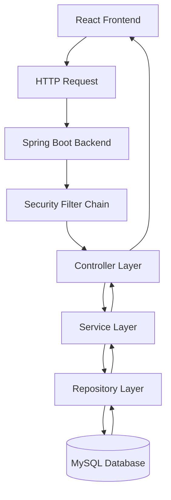

# WorkBridge — REST API Overview

## 1. Purpose

This document describes the REST API architecture and communication standards for the WorkBridge application.

WorkBridge uses a Spring Boot backend to expose APIs consumed by the React frontend.

The API layer is responsible for:
- User authentication and authorization.
- Worker and contractor profile management.
- Service listing management.
- Worker applications.
- Workforce allocation.
- Notifications.
- Payment and payout operations.
- Super Admin operations.

This document establishes the API documentation structure. Exact endpoint definitions must be verified against the existing WorkBridge backend.

## 2. API Architecture

WorkBridge follows a client-server architecture.



### Request flow

1. The React frontend sends an HTTP request.
2. The Spring Boot backend receives the request.
3. Security filters process authentication and authorization.
4. The controller handles the incoming request.
5. The service layer executes business logic.
6. The repository layer accesses the database.
7. The response is returned to the frontend.

## 3. API Technology

| Component | Technology |
|---|---|
| Backend framework | Spring Boot |
| API architecture | REST |
| Programming language | Java |
| Security | Spring Security |
| Authentication | JWT |
| Persistence | Spring Data JPA |
| Database | MySQL |
| Frontend | React |
| Frontend build tool | Vite |
| API communication | HTTP |

## 4. API Design Principles

The WorkBridge API should follow these principles:

### 4.1 Resource-Based Design

Endpoints should represent application resources.

Examples of resource categories:

- Users
- Worker profiles
- Contractor profiles
- Service listings
- Applications
- Notifications
- Payments
- Payouts
- Administration

Actual resource names and endpoint paths must match the existing implementation.

### 4.2 HTTP Methods

| HTTP Method | General purpose |
|---|---|
| GET | Retrieve resources |
| POST | Create resources or perform supported actions |
| PUT | Replace or update a resource |
| PATCH | Partially update a resource |
| DELETE | Delete a resource |

The actual HTTP method used by each existing endpoint must be verified.

### 4.3 JSON Communication

The frontend and backend communicate using HTTP requests and responses.

JSON is the expected API data format where supported by the existing endpoint.

Example request:

```json
{
  "exampleField": "exampleValue"
}
```

This is a format illustration, not an actual WorkBridge request schema.

## 5. Authentication and Authorization

WorkBridge uses JWT-based authentication with Spring Security.

The API security design must support:

- User authentication.
- Token-based request authentication.
- Role-based authorization.
- Protected endpoints.
- Super Admin operations.
- Contractor account blocking and unblocking.

The exact authentication endpoints, token format, claims, expiration settings, and authorization rules must be verified against the old implementation.

### Authorization responsibilities

| Role | General responsibility |
|---|---|
| Worker | Access worker-related functionality |
| Contractor | Manage contractor-related functionality |
| Super Admin | Perform platform administration |

The complete permission matrix will be documented separately.

## 6. API Response Standards

API responses should communicate the result of a request clearly.

The exact response structure must be extracted from the existing controllers and response DTOs.

The following is an illustrative success response:

```json
{
  "success": true,
  "message": "Operation completed successfully",
  "data": {}
}
```

The following is an illustrative error response:

```json
{
  "success": false,
  "message": "Request could not be processed",
  "errors": []
}
```

These structures are examples only. They are not confirmed WorkBridge response contracts.

## 7. HTTP Status Codes

The API may use the following standard HTTP status codes where appropriate.

| Status code | Meaning |
|---|---|
| 200 | OK |
| 201 | Created |
| 204 | No Content |
| 400 | Bad Request |
| 401 | Unauthorized |
| 403 | Forbidden |
| 404 | Not Found |
| 409 | Conflict |
| 415 | Unsupported Media Type |
| 500 | Internal Server Error |

The status code returned by each existing endpoint must be verified.

## 8. API Module Organization

The API documentation will be organized into the following functional modules.

| Module | Responsibility |
|---|---|
| Authentication | Login and authentication operations |
| User | User account operations |
| Worker | Worker profile operations |
| Contractor | Contractor profile operations |
| Service Listing | Create and manage work opportunities |
| Application | Worker application operations |
| Workforce Allocation | Application approval and allocation |
| Notification | Notification operations |
| Payment | Payment operations |
| Payout | Payout operations |
| Super Admin | Administrative operations |

This is a documentation grouping, not a decision to create new backend modules or change existing endpoint organization.

## 9. Validation and Error Handling

Incoming API requests must be validated before business operations are performed.

The existing implementation's validation rules and error response format must be preserved.

The API documentation should record:

- Required request fields.
- Field formats and constraints.
- Authentication requirements.
- Authorization requirements.
- Validation failure responses.
- Business rule violations.
- Database-related failures.

## 10. API Documentation Format

Each endpoint will be documented using the following structure.

| Field | Description |
|---|---|
| Endpoint name | Name of the API operation |
| HTTP method | GET, POST, PUT, PATCH or DELETE |
| Endpoint URL | Actual API path |
| Authentication | Whether authentication is required |
| Authorization | Permitted role or roles |
| Path parameters | Parameters in the URL |
| Query parameters | Parameters in the query string |
| Request headers | Required headers |
| Request body | Expected request structure |
| Success response | Actual response structure |
| Error responses | Possible error responses |
| Business logic | Operation performed by the backend |

No endpoint paths or request schemas will be invented.

## 11. API Verification Requirements

Before documenting individual endpoints, inspect the existing backend source code.

Verify:

- Controller class names.
- Request mappings.
- HTTP methods.
- Endpoint paths.
- Request parameters.
- Request DTOs.
- Response DTOs.
- Authentication requirements.
- Role-based authorization annotations.
- HTTP response status codes.
- Exception handling.
- Multipart or file upload requirements, if present.

## 12. Planned API Documentation Files

The following documents are planned under `docs/04-API/`.

1. `rest-api-overview.md`
2. `authentication-and-authorization-api.md`
3. `user-and-profile-api.md`
4. `service-listing-api.md`
5. `application-and-allocation-api.md`
6. `notification-api.md`
7. `payment-and-payout-api.md`
8. `super-admin-api.md`

The sequence may be adjusted if source-code inspection reveals a different existing API organization.

## 13. Completion Criteria

The API documentation phase is complete when:

- All existing endpoints are documented.
- Request and response structures are verified.
- Authentication and authorization requirements are documented.
- Error responses are documented.
- API behavior matches the existing WorkBridge implementation.
- No unsupported endpoints or features are introduced.

**Next document:** `docs/04-API/authentication-and-authorization-api.md`