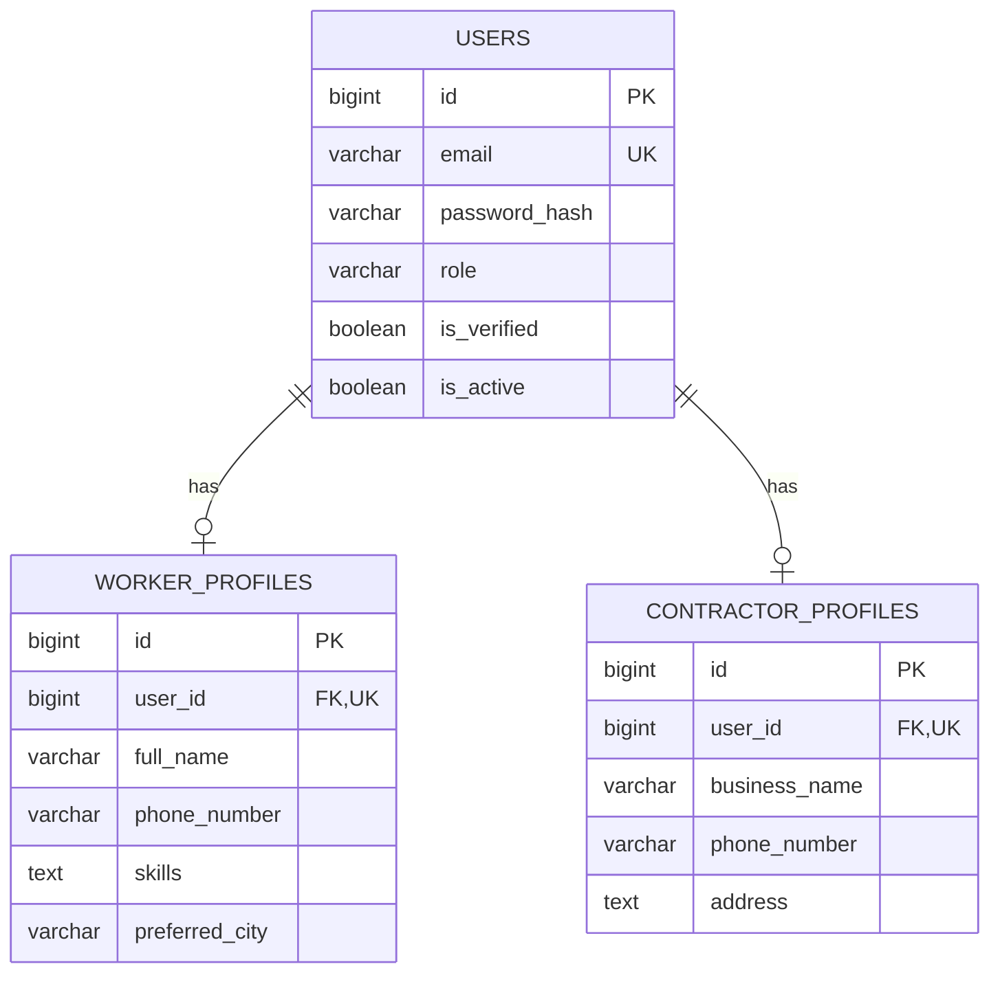

# User and Profile API Documentation

## 1. Purpose

This document describes the user account and role-specific profile structure implemented in the original WorkBridge backend.

It covers:

- User account registration.
- Worker profile creation.
- Contractor profile creation.
- Login response and profile identification.
- User roles and profile data.
- Current limitations in profile retrieval and management.

**Source of truth:** Original WorkBridge backend source code and its React frontend.

## 2. User Roles

The backend defines the following roles in `Role.java`:

| Role | Description |
|---|---|
| `ROLE_WORKER` | User who searches for services and applies for work. |
| `ROLE_CONTRACTOR` | User who publishes services and manages worker applications. |
| `ROLE_ADMIN` | Administrative user with elevated permissions. |

The role is stored in the `users` table as an enum string.

## 3. User Account Model

**Entity:** `User`

**Table:** `users`

| Field | Type | Description |
|---|---|---|
| `id` | Long | Primary key |
| `email` | String | Unique email address |
| `passwordHash` | String | BCrypt-encoded password |
| `role` | Role | User role |
| `verified` | Boolean | Account verification status |
| `active` | Boolean | Account active status |
| `createdAt` | LocalDateTime | Account creation timestamp |
| `updatedAt` | LocalDateTime | Last modification timestamp |

The user account is the base identity for both worker and contractor profiles.

## 4. Worker Profile Model

**Entity:** `WorkerProfile`

**Table:** `worker_profiles`

| Field | Type | Description |
|---|---|---|
| `id` | Long | Primary key |
| `user` | User | Associated user account |
| `fullName` | String | Worker's full name |
| `phoneNumber` | String | Contact number |
| `skills` | String | Worker's skills |
| `preferredCity` | String | Preferred working city |
| `createdAt` | LocalDateTime | Profile creation timestamp |
| `updatedAt` | LocalDateTime | Last modification timestamp |

Each worker profile is associated with exactly one user account through a unique `user_id` foreign key.

## 5. Contractor Profile Model

**Entity:** `ContractorProfile`

**Table:** `contractor_profiles`

| Field | Type | Description |
|---|---|---|
| `id` | Long | Primary key |
| `user` | User | Associated user account |
| `businessName` | String | Contractor's business name |
| `phoneNumber` | String | Contact number |
| `address` | String | Business address |
| `createdAt` | LocalDateTime | Profile creation timestamp |
| `updatedAt` | LocalDateTime | Last modification timestamp |

Each contractor profile is associated with exactly one user account through a unique `user_id` foreign key.

## 6. User Registration API

### Endpoint

`POST /api/auth/register`

**Controller:** `AuthController`

**Request DTO:** `RegisterRequest`

**Success status:** `201 Created`

### Request fields

| Field | Required | Description |
|---|---|---|
| `email` | Yes | Valid email address |
| `password` | Yes | Minimum 6 characters |
| `role` | Yes | `ROLE_WORKER` or `ROLE_CONTRACTOR` for profile creation |
| `fullName` | Yes | User's full name |
| `phoneNumber` | Yes | Contact number |
| `businessName` | No | Contractor business name |
| `address` | No | Contractor address |
| `skills` | No | Worker skills |
| `preferredCity` | No | Worker's preferred city |

### Worker registration example

```json
{
  "email": "worker@example.com",
  "password": "password123",
  "role": "ROLE_WORKER",
  "fullName": "Arun Kumar",
  "phoneNumber": "9876543210",
  "skills": "Catering, Cleaning",
  "preferredCity": "Bengaluru"
}
```

### Contractor registration example

```json
{
  "email": "contractor@example.com",
  "password": "password123",
  "role": "ROLE_CONTRACTOR",
  "fullName": "Ravi Kumar",
  "phoneNumber": "9876543210",
  "businessName": "Ravi Event Services",
  "address": "Bengaluru"
}
```

### Registration business logic

The `AuthService.register()` method performs these operations:

1. Checks whether the email already exists.
2. Encodes the password using BCrypt.
3. Creates the base `User` record.
4. Sets `verified = true` and `active = true`.
5. Checks the requested role.
6. Creates a `WorkerProfile` for a worker account.
7. Creates a `ContractorProfile` for a contractor account.
8. Saves the profile and obtains its ID.
9. Authenticates the newly registered user.
10. Generates access and refresh tokens.
11. Returns the authentication response.

For contractors, if `businessName` is not supplied, the backend uses the user's full name followed by `Services`.

For `ROLE_ADMIN`, the current registration service does not create a worker or contractor profile. The returned `profileId` remains null.

## 7. Login API

### Endpoint

`POST /api/auth/login`

**Controller:** `AuthController`

**Request DTO:** `LoginRequest`

**Success status:** `200 OK`

### Request body

```json
{
  "email": "worker@example.com",
  "password": "password123"
}
```

### Login business logic

1. Authenticates the email and password through Spring Security.
2. Retrieves the corresponding user account.
3. Identifies the user's role.
4. Retrieves the worker or contractor profile ID, where applicable.
5. Generates access and refresh tokens.
6. Returns the authentication response.

Invalid login attempts return an unauthorized error through the authentication service.

## 8. Authentication Response

**DTO:** `AuthResponse`

The registration and login APIs return the following response structure:

```json
{
  "accessToken": "generated-access-token",
  "refreshToken": "generated-refresh-token",
  "email": "worker@example.com",
  "role": "ROLE_WORKER",
  "userId": 1,
  "profileId": 1
}
```

| Field | Description |
|---|---|
| `accessToken` | JWT access token |
| `refreshToken` | JWT refresh token |
| `email` | Registered email |
| `role` | User role |
| `userId` | User account ID |
| `profileId` | Corresponding worker or contractor profile ID; null for admin accounts |

## 9. Profile Relationship

The original backend uses a one-to-one relationship between the user account and each role-specific profile.



The relationship is implemented using `@OneToOne` and a unique `user_id` foreign key in both profile entities.

## 10. Current Profile API Status

**Important source-code finding:** The original backend does not contain a dedicated user/profile controller.

The backend currently exposes these account-related endpoints:

| Method | Endpoint | Purpose |
|---|---|---|
| POST | `/api/auth/register` | Register a user and create the applicable profile |
| POST | `/api/auth/login` | Authenticate a user and return tokens and IDs |

The following profile operations are **not implemented as backend APIs** in the inspected source:

- Retrieve the currently authenticated user's complete profile.
- Retrieve a worker profile by ID.
- Retrieve a contractor profile by ID.
- Update worker profile details.
- Update contractor profile details.
- Change account email or password through a profile API.

### Frontend observation

The React application contains a Profile screen. However, the inspected frontend does not make a dedicated profile API request.

The screen reads values from its local `user` state. The login and registration handlers currently store email, role, user ID, and profile ID in that state.

Consequently, the displayed profile information is not backed by a complete profile-fetch operation.

These missing endpoints must not be treated as existing functionality.

## 11. Rebuild Considerations

During the Spring Boot rebuild, preserve the original account and profile behavior:

- Maintain the base `User` entity.
- Maintain separate `WorkerProfile` and `ContractorProfile` entities.
- Maintain the one-to-one relationship.
- Encode passwords using BCrypt.
- Create the role-specific profile during registration.
- Return both `userId` and `profileId` in the authentication response.
- Preserve the existing role names.

Any new profile retrieval or update endpoints must be explicitly agreed upon before implementation. They are not part of the original backend API.

---

